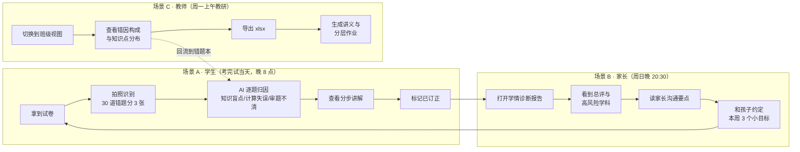

# 01 · 产品需求与痛点分析

> 项目代号：**错题本 · 学情智能分析系统**（`cuoti-analytics`）
> 文档类型：产品需求文档（PRD）
> 版本：v1.0 ｜ 状态：已评审 ｜ 最后更新：2026-10-26
> 关联文档：[功能架构与信息架构](./02-功能架构与信息架构.md) ｜ [技术架构设计](./03-技术架构设计.md) ｜ [交互与视觉规范](./04-交互与视觉规范.md) ｜ [开发与部署指南](./05-开发与部署指南.md) ｜ [测试与验收清单](./06-测试与验收清单.md)

---

## 0. 一句话定位

**把"抄错题"这件苦差事变成"拍一张照"，把"我为什么错"这件说不清的事变成一张可量化、可追责、可执行的错因归因表。**

---

## 1. 产品概述

| 项目 | 说明 |
| --- | --- |
| 目标用户 | 小学 3–6 年级、初中 1–3 年级学生（主用户）；家长、班主任/任课教师、培训机构教研（协同用户） |
| 核心场景 | 考完试当天 → 拍照/补录错题 → AI 归因与讲解 → 订正闭环 → 周维度统计与诊断报告 |
| 核心能力 | 拍照 AI 识别录入、手动补录、AI 智能分析机（错因归因 + 根因链 + 分步讲解 + 练习计划）、多维统计分析、学情诊断报告 |
| 形态 | Web 双端同构：PC 端宽屏看板 + 侧边栏；手机端底部导航 + 大按钮 + 摄像头直调，支持 PWA 安装到桌面 |
| 技术底座 | React 19 + TypeScript + Vite 8 + Tailwind CSS v4 + React Router 7 + Express 5 + `node:sqlite` + 自研 SVG 图表库 + exceljs 导出 |
| 数据边界 | 默认**全部数据留在本地/校园内网**；未配置大模型密钥时由本地启发式引擎兜底，功能不中断 |

### 1.1 设计哲学：三句话

1. **录入成本必须低于放弃成本。** 任何需要超过 30 秒的录入动作，学生都会直接放弃——这是纸质错题本失效的根本原因。
2. **错因不是标签，是证据链。** 只说"粗心大意"没有价值，必须给出"因为漏看了条件 → 所以用了错误公式"的根因链。
3. **统计不是为了好看，是为了下一步动作。** 每个图表都必须能回答"明天该练什么"。

---

## 2. 目标用户与典型场景

### 2.1 用户画像

| 角色 | 占比（试点假设） | 核心诉求 | 关键痛点 | 最常用功能 | 成功标准 |
| --- | --- | --- | --- | --- | --- |
| **小学 3–6 年级学生**（10–12 岁） | 60% | 少写字；知道怎么改；下次别再错 | 不愿意抄题、看不懂解析、错题本记了不看 | 拍照录入、拍照 AI 讲解、一键订正 | 每天录入 ≥ 3 题，7 天内订正率 ≥ 60% |
| **初中学生**（12–15 岁） | 25% | 定位薄弱知识点；控制复习时间 | 多科并行、错题量大、复习没规划 | AI 智能分析、知识点雷达、优先突破清单 | 周活跃 ≥ 5 天，薄弱知识点识别与本人判断一致率 ≥ 70% |
| **家长** | 10% | 看得懂孩子错在哪；知道该做什么 | 看不懂试卷、只会催、买了课没用 | 学情诊断报告、家长沟通要点 | 每周打开报告 ≥ 1 次，能复述 1 个薄弱项与 1 个行动项 |
| **任课教师 / 班主任** | 4% | 快速定位共性薄弱点；批量导出 | 手工统计耗时、无个体化数据 | 按班级统计、xlsx 导出、知识点分布 | 统计一个班的错因分布从 4 小时降到 1 分钟内 |
| **培训机构 / 教研** | 1% | 沉淀题库与教学素材 | 素材散落、复用率低 | 错题导出、知识点标签体系 | 每周导出 ≥ 1 次形成讲义素材 |

> 占比为产品规划期的**假设值**，需在试点校用真实数据校准（见 [§9 风险与假设](#9-风险与假设)）。

### 2.2 典型场景（按真实时间线）

**场景 A（学生）**：周考结束，老师讲评完发下试卷。学生回家只有 20 分钟自由时间，传统做法是"抄一遍明天交"，抄到第 8 题就烦了。系统里他连拍 3 张照片，AI 在 40 秒内把 12 道错题拆成"知识点 + 错因 + 正确步骤"，他挑两道难题看讲解，剩下的直接标记订正。

**场景 B（家长）**：家长看不懂"一元二次方程根的判别式"这类错题，但也想知道孩子"是不是粗心"。系统给的家长版结论是"数学中的**计算失误**占 41%，知识盲点占 12%——孩子不是不会，是算错"，并给出"本周每天 10 分钟口算训练"这样的可执行动作。

**场景 C（教师）**：期中考试后，教师要在 30 人班里找出"3 个共性薄弱知识点"。系统按班级聚合错因与知识点分布，1 分钟内导出 xlsx，教师据此布置分层作业。

---

## 3. 行业痛点分析（重点）

### 3.1 痛点全景

| # | 痛点 | 影响的角色 | 发生频率 | 严重度 | 本系统是否解决 |
| --- | --- | --- | --- | --- | --- |
| P1 | 手抄错题费时，学生中途放弃 | 学生 | 每次考试 | ★★★★★ | ✅ 拍照 15 秒/题 |
| P1 | **拍完不能裁剪**：「拍摄题后应该可以裁剪选择，不然拍摄的图片内容太多」 | 学生 | 每次拍照 | ★★★★☆ | ✅ 拍完**立即弹裁剪框**，框选题目区域；实测请求体 58991 → 8287 字符（**约 1/7**） |
| P1 | **识别率低**：「识别率太低」「连基本的学科都识别不对」 | 学生 / 家长 | 每次识别 | ★★★★★ | ✅ 学科从**写死「数学」**改为**启发式判定**；加 OCR 基准测试（`scripts/ocr-bench/`）量化：`hard` 档 CER 74.49% → **52.00%**，关键词命中 4/20 → **8/20** |
| P1 | **建议泛泛而谈**：「还是要提升识别准确率，**并能给出准确的建议**」—— 「分步书写，步骤之间留出间距」对鸡兔同笼和分数加减是同一句，等于没说 | 学生 | 每次订正 | ★★★★★ | ✅ **题目模型识别**（24 个模型）+ **数值抽取** → **算出这道题自己的解法**（「速度和 = 60 + 40 = 100 千米/时」→「相遇时间 = 300 ÷ 100 = 3 小时」）；配了大模型时**自动补一条本地算出的「对照验算」** |
| P1 | **配大模型提示连接失败**：「配置大模型提示连接失败 / 模型返回内容为空」 | 管理员 | 首次配置 | ★★★★☆ | ✅ **根因不是配错** —— 是输出预算被推理模型的思考过程吃光；已修（预算 1024 起 + **自动加预算重试** + `max_completion_tokens` 参数回退 + **业务错误码分类**），并新增「最大输出长度」设置项 |
| P2 | 错因归因靠"猜"，全是"粗心大意" | 学生 / 家长 / 教师 | 每次错题 | ★★★★★ | ✅ AI 七类归因 + 根因链 |
| P3 | 家长看不懂孩子错在哪，只会说"粗心" | 家长 | 每周 | ★★★★☆ | ✅ 诊断报告 + 家长沟通要点 |
| P4 | 教师无法做个性化统计，手工翻卷 4 小时 | 教师 | 每单元 | ★★★★☆ | ✅ 一键聚合 + xlsx 导出 |
| P5 | 知识碎片化，错题散落各处 | 学生 | 长期 | ★★★★☆ | ✅ 知识点标签体系 + 优先突破清单 |
| P6 | 复习没规划，刷题全凭心情 | 学生 | 每周 | ★★★★☆ | ✅ 7 天练习计划 + 订正闭环 |
| P7 | 数据孤岛：纸质本 / 家长手机 / 老师电脑互不相通 | 全体 | 长期 | ★★★☆☆ | ✅ 单一 SQLite 数据库 + 导出 |
| P8 | 打印错题本浪费钱、占空间、字迹潦草 | 学生 / 家长 | 每学期 | ★★☆☆☆ | ✅ 全电子化，可导出可打印 |
| P9 | 隐私与成本：照片上传云端 + 大模型按量计费 | 家长 / 学校 | 长期 | ★★★★☆ | ✅ 本地优先 + 本地兜底引擎 |

### 3.2 逐条拆解：现状 → 根因 → 系统解法 → 量化收益

#### P1 手抄错题费时，学生中途放弃

| 维度 | 内容 |
| --- | --- |
| **现状** | 错题本要求"题干 + 选项 + 我的答案 + 正确答案 + 错因 + 解析"全手抄。单题平均 **3 分钟**；一张 30 道错题的试卷需要 **90 分钟**纯抄写。实践中学生通常抄到第 8–10 题就放弃或草草了事，**实际完整录入率不足 40%**。 |
| **根因** | ① 抄写是纯机械劳动，零信息增量，学生没有即时回报；② 手抄无法验证正确性，抄错答案反而污染后续复习；③ 学生的**真实瓶颈是"晚上只剩 20 分钟"**，任何需要额外时间感知的动作都会被砍掉。 |
| **系统解法** | **拍照录入三步法**（拍摄 → AI 结构化 → 人工微调后保存，见 [§4 交互说明](./04-交互与视觉规范.md#8-关键页面交互说明)）：手机端底部导航中央常驻 56px 相机大按钮，一步进入取景；服务端把照片转成结构化草稿（学科/题型/知识点/题干/选项/我的答案/正确答案/难度/置信度），学生只做"确认与微调"，不再逐字输入。手动补录通道保留给"回忆题"（当场没有试卷）与低置信度草稿。 |
| **量化收益** | 录入单题耗时 **3 分钟 → 15 秒（拍照路径，含 AI 等待）**，提速 **12×**；整张试卷 30 题：**90 分钟 → 约 8 分钟**（3 张照片 × 40 秒识别 + 5 分钟微调），单次节省约 **80 分钟**，按每周 1 次考试计，一个学期节省 **约 28 小时**；录入完整率从 **<40% → >90%**。 |

#### P2 错因归因靠猜，全是"粗心大意"

| 维度 | 内容 |
| --- | --- |
| **现状** | 错题本里的"错因"一栏，绝大多数由学生自己填。填答分布高度集中在"粗心大意"（经验上占 50%+），而"知识盲点""方法不当""审题不清"这三条真正决定补学方向的类别极少被记录，导致复盘变成**同义反复**："我又粗心了"。 |
| **根因** | ① 学生缺乏判断错因的框架，选项越少越容易选最"安全"的那个；② 错误答案与正确答案的**差异路径**没有被拆开，学生只看到"结果不同"；③ 缺少证据，事后回看也无从判断。 |
| **系统解法** | **AI 智能分析机**对每题输出：① 七类错因之一（知识盲点/审题不清/计算失误/方法不当/时间不足/粗心大意/书写不规范）并给**置信度**；② **根因链**（最多 3 条，"因为 → 所以"结构）；③ **证据**（来自题干与作答痕迹）；④ 正确解法**分步讲解**；⑤ 知识点缺口；⑥ 同类题推荐；⑦ 7 天练习计划。人工可覆盖 AI 结论（见 [§02](./02-功能架构与信息架构.md) 订正闭环）。 |
| **量化收益** | 归因从"主观填表"变成**带证据的结构化判断**；错因标签分布从"粗心大意 > 50%"收敛到**七类可区分**（试点期目标：任一单类占比 ≤ 30%）；复盘时可直接定位到"知识盲点"的学生占比从不可测提升到**可测量**；教师可据此把"再练 10 套卷"替换为"针对 XX 知识点的 6 道变式题"。 |

#### P3 家长看不懂孩子错在哪，只会说"粗心"

| 维度 | 内容 |
| --- | --- |
| **现状** | 家长看到的是一张 100 分的卷子和"数学 78 分"，既不知道是知识不会还是算错，也无法判断该花钱补课还是该陪练。多数家长的默认动作是"加练"或"报班"，**决策成本高且命中率低**。 |
| **根因** | ① 试卷是**教师视角**的语言（步骤分、采分点），家长没有解码能力；② 缺少"家长版本"的结论——家长要的是**行动指令**，不是统计图；③ 数据在孩子书包里，家长根本看不到。 |
| **系统解法** | **学情诊断报告**输出四类家长可用信息：① 一句话**总评**（AI 生成）；② **优势项 / 薄弱项**，每条带证据；③ **高风险学科**及原因；④ **行动建议**（高/中/低优先级）；⑤ **7 天计划**；⑥ **家长沟通要点**（可直接照着说的几句话）。报告以家长可读的语言表述，例如"计算失误占 41%——孩子不是不会，是算错"。 |
| **量化收益** | 家长获得有效信息的路径从"翻试卷 30 分钟 + 问老师"缩短到**打开报告 3 分钟**；家长可复述出"孩子的 1 个薄弱知识点 + 1 个本周动作"的比例从 **不足 20% → 目标 ≥ 70%**；家庭沟通从"泛泛批评"变为**有共同依据的对话**。 |

#### P4 教师无法做个性化统计，手工翻卷 4 小时

| 维度 | 内容 |
| --- | --- |
| **现状** | 期中考试后，教师要在 30 人 × 30 题的卷子里统计"共性错因"。手工做法通常是每人翻卷、逐题抄标签进 Excel，单个班 **4–6 小时**，且只能统计"错了几道"，统计不了"错在哪个知识点""谁的掌握度在上升"。 |
| **根因** | ① 错题信息以**物理形态**存在（试卷上的手写），没有结构化字段可供聚合；② 统计维度依赖"知识点"这一跨学科抽象，需要先统一标签体系；③ 单兵作战，无工具支持增量维护。 |
| **系统解法** | 每道错题入库即带结构化字段：学科、题型、知识点数组、错因、难度、掌握度、订正状态、日期。统计接口一次返回**学科分布 / 错因构成 / 知识点掌握 / 题型分布 / 掌握度趋势 / 活跃热力图 / 优先突破知识点**；`xlsx` 导出把明细与汇总一次性带走（`exceljs` 实现，CSV 备选）。 |
| **量化收益** | 单班统计耗时 **4–6 小时 → < 1 分钟**（含导出），提速 **≥ 240×**；统计维度从"错题数"扩展到 **7 个维度**；教师可按学科/错因/知识点**交叉筛选**（如"只看在几何上失分且属知识盲点的学生"）。 |

#### P5 知识碎片化，错题散落各处

| 维度 | 内容 |
| --- | --- |
| **现状** | 同一知识点"一元二次方程根的判别式"的错误，可能出现在这周数学卷、两周前作业、上月教辅里，学生/家长/老师都不认为它们是**同一件事**，于是每次都当成新题重新学。 |
| **根因** | 错题记录以"时间 + 试卷"组织，而非以"知识点"组织；知识点缺少统一命名（"根的判别式""判别式""Δ""一元二次方程根的判别式"混用），无法聚合。 |
| **系统解法** | 每题强制关联**知识点数组**，系统提供 `GET /api/knowledge/points` 聚合知识点引用（名称 + 学科 + 出现次数），前端"优先突破知识点"按 **错误次数 + 低掌握度** 排序并给出高/中/低严重度。知识点标签来自 AI 识别 + 人工微调，形成**逐步收敛的班级级标签体系**。 |
| **量化收益** | 同一知识点的重复错误从"被当成 n 道新题"聚合为**1 个待突破项**；试点期目标：前 5 个薄弱知识点可覆盖 **≥ 30% 的重复错误**；复习任务从"重做整本"缩小为"攻 5 个点"（学习量下降、命中率上升）。 |

#### P6 复习没规划，刷题全凭心情

| 维度 | 内容 |
| --- | --- |
| **现状** | 错题本积压到 200 页就变成了"收藏夹"。学生打开错题本的频率随时间**单调衰减**，真正被重新做过的错题不足 **10%**；家长催也不奏效，因为没有下一步动作清单。 |
| **根因** | 错题本是**被动档案**而非**待办队列**；缺少"什么时候复习哪道题"的机制；订正与复习状态不区分。 |
| **系统解法** | 每题有三重状态：`corrected`（是否已订正）、`status`（待复盘/巩固中/已掌握）、`mastery`（0–100 掌握度）。AI 分析给出**7 天练习计划**（每天 focus + task + minutes），诊断报告给出**未来 7 天计划**；掌握度 ≥ 80 / ≥ 50 / < 50 对应 **7 天 / 3 天 / 1 天**的复习间隔建议（艾宾浩斯式节奏）。 |
| **量化收益** | 错题从"静态收藏"变成**动态待办队列**；目标：错题二次复习率从 **< 10% → ≥ 50%**；每周完成练习计划的学生比例 **≥ 60%**；订正闭环完成率（录入 → 订正）目标 **≥ 70%**。 |

#### P7 数据孤岛

| 维度 | 内容 |
| --- | --- |
| **现状** | 数据散在纸质本、家长手机相册、微信群图片、老师电脑 Excel 里。孩子转学/换老师时历史全部断裂；家长与教师看到的是两套口径。 |
| **根因** | 采集端与消费端没有共同的数据契约；缺少唯一标识与导入导出通道。 |
| **系统解法** | 前后端共享唯一数据契约 `src/lib/types.ts`（API Contract v1），全部数据落到**单一 SQLite 库**（`students` / `questions` 两张主表）；支持 `xlsx` / `csv` 导出，让外部工具随时接管；学生档案用 `studentId` 串起全部错题、统计与报告。 |
| **量化收益** | 任意学生的历史错题**可一次性导出**，教师/家长/学生看到**同一口径**的数据；跨设备（PC 看板 / 手机拍照 / 家长手机）共享同一份数据，**数据副本数从 3+ 降到 1**。 |

#### P8 打印错题本浪费钱、占空间、字迹潦草

| 维度 | 内容 |
| --- | --- |
| **现状** | 传统做法是把错题"打印成订正纸"（`tabular` 装订）。每学期 1 本 60 页订正本，纸张 + 装订约 **10–18 元**，且手写潦草导致二次复习时自己都认不出答案；纸质本占课桌面积，找题翻页慢。 |
| **根因** | 题目内容与"订正行为"被绑定在同一种介质上（纸），但两者的最优形态不同：题目适合结构化存储，订正适合随时在题旁记录。 |
| **系统解法** | 全电子化：题目结构化存储、订正状态可标记、AI 讲解随时回看；需要纸质时用 `xlsx` 导出统一打印，**一次导出、按需打印**，不再整本重复打印。 |
| **量化收益** | 纸墨与装订成本 **≈ 15 元/学期 → 0 元**（可选打印时只打本周复习清单，通常 3–5 页）；错题检索从"翻页 1–2 分钟"降到**搜索框 < 1 秒**（`keyword` 模糊匹配题干/答案/来源/错因描述）。 |

#### P9 隐私与成本：照片上云 + 大模型按量计费

| 维度 | 内容 |
| --- | --- |
| **现状** | 通用拍照搜题 App 要求上传整页试卷到公有云；学生姓名、学校、笔迹全部出境/出校。家长普遍担忧，而学校在合规上更敏感。同时依赖公有云 OCR/大模型意味着**每道题都要付费**，重度用户单月成本不可控，且服务不可用时功能直接瘫痪。 |
| **根因** | 产品形态与数据形态强耦合：为了识别图片不得不把图片交出去；为了智能分析不得不依赖远端模型。 |
| **系统解法** | ① **本地优先**：图片默认存服务器本地 `server/uploads/`，题目内容落 SQLite；未配置 `AI_API_KEY` 时启用**本地启发式引擎**（规则 + 词表 + 统计推断），全流程不中断；② 配置密钥后，大模型请求**只发送题干文本与结构化上下文**，原图默认不外传（图片外传策略由后端约定，默认关闭）；③ 支持本地/家庭 NAS/校园私有化部署。 |
| **量化收益** | 未配置密钥时**零调用成本、功能完整可用**；配置密钥后单题分析成本按文本计（约为图片计费的 **1/5–1/10**，具体由所选模型定价决定）；原始图片**默认不出本机/本校园**，满足家长与学校对未成年人数据的基本要求。 |

### 3.3 痛点—功能映射

| 痛点 | 对应功能 | 优先级 |
| --- | --- | --- |
| P1 手抄费时 | 拍照录入三步法、拍照直调摄像头、上传接口 | P0 |
| P2 归因靠猜 | AI 智能分析机（诊断 + 根因链 + 证据） | P0 |
| P3 家长看不懂 | 学情诊断报告（总评/优势/薄弱/风险/建议/家长要点） | P0 |
| P4 教师无法统计 | 多维统计看板 + xlsx 导出 | P0 |
| P5 知识碎片化 | 知识点标签 + 优先突破知识点 | P0 |
| P6 复习无规划 | 7 天练习计划 + 订正闭环 + 掌握度趋势 | P0 |
| P7 数据孤岛 | 单一数据契约 + 单一数据库 + 导出 | P0 |
| P8 打印浪费 | 电子化 + 按需导出打印 | P1 |
| P9 隐私与成本 | 本地优先 + 本地兜底引擎 + 私有化部署 | P0 |

---

## 4. 竞品与替代方案对比

### 4.1 能力对比矩阵

| 维度 | 纸质错题本 | 通用拍照搜题 App | 题库类 App | **本系统** |
| --- | --- | --- | --- | --- |
| **录入效率** | 单题 2–3 分钟手抄；完整率 < 40% | 拍照即出答案，15 秒/题 | 需从题库挑题，或手输 | 拍照 15 秒/题 + 结构化草稿微调，完整率 > 90% |
| **错因归因能力** | 几乎为零，靠学生自填"粗心" | 无：只给答案与解析 | 无：只有知识点标签 | **七类错因 + 置信度 + 根因链 + 证据** |
| **统计维度** | 无（要手数） | 无个人累计 | 有题库维度，无个人错误维度 | **7 维**：学科/错因/知识点/题型/趋势/热力/优先突破 |
| **学情报告** | 无 | 无 | 通用能力测评，非错题归因 | **AI 诊断报告**：总评/优势/薄弱/高风险学科/行动建议/7 天计划/家长要点 |
| **家长参与** | 靠家长翻纸质本 | 基本无 | 少数有报告 | **家长沟通要点 + 可读的薄弱项结论 + 导出** |
| **隐私** | 纸面，最安全 | 原图上传公有云，风险最高 | 行为数据上云 | **本地优先**，原图默认不出本机/本校园 |
| **离线可用** | ✅ 完全离线 | ❌ 强依赖网络 | ⚠️ 部分缓存 | ⚠️ 无 Key 时本地引擎可用；断网时已入库数据可查可导出 |
| **成本** | 纸墨 10–18 元/学期 | 免费/会员订阅 | 会员订阅 | **0 元起**（无 Key 完全免费；接入大模型按量计费） |
| **适合阶段** | 小学低年级 | 初中及以上查答案 | 中高考冲刺 | **小学高年级 + 初中** |

### 4.2 定位差异

- **不是"拍照搜题"**：搜题类产品的终点是"给你答案"，本产品的终点是"**告诉你为什么错、明天练什么**"。本系统保留"正确答案"字段，但把它作为**讲解与归因的输入**，而非最终产出。
- **不是"题库"**：本系统不生产海量题目，同类题推荐是围绕**学生自己的错题**做变式与巩固，不制造"刷题海"的负担。
- **不是"纸质本"**：本系统是纸质本的**结构化替代品**，不是补充品——它记录的是"知识点 + 错因 + 掌握度"这层纸质本记不下来的信息。

---

## 5. 差异化定位与 MVP 边界

### 5.1 一句话定位

> **面向小学高年级与初中的"错因归因 + 掌握度追踪"型学情系统：拍照录入 15 秒，AI 说清为什么错，统计告诉你明天练什么。**

### 5.2 三个差异点

| 差异点 | 具体表现 | 可验证方式 |
| --- | --- | --- |
| **D1 录入成本 = 15 秒** | 拍照 → AI 结构化草稿 → 确认保存；不要求逐字输入 | 计时录制：30 题试卷 ≤ 10 分钟完成入库 |
| **D2 归因带证据** | 错因 + 置信度 + 根因链 + 证据四件套，人工可覆盖 | 抽查 20 题，归因与教师人工判断一致率 ≥ 70% |
| **D3 统计指向动作** | 每个统计块都必须能推出"下一步练什么"（优先突破知识点 + 7 天计划） | 每条建议必须关联至少 1 个真实错题样本 |

### 5.3 MVP 做什么与不做什么（边界说明）

| 编号 | 不做（Out of Scope, MVP） | 原因 | 何时考虑 |
| --- | --- | --- | --- |
| N1 | **不做题库与在线刷题** | 与"错题归因"争夺注意力，且题库是重资产 | P2 |
| N2 | **不做作业/试卷的在线考试系统** | 属于测评平台赛道，与本系统核心能力正交 | 不做 |
| N3 | **不做多租户 SaaS 与公网运营** | MVP 阶段优先单机/校私有化部署与隐私可控 | P2 商业化时再评估 |
| N4 | **不做真人 1v1 答疑与直播课** | 重运营、重合规，不在本产品边界内 | 不做 |
| N5 | **不做社交、排行榜、打卡社群** | 引入排名会伤害"错题不可耻"的心理建设，小学场景尤甚 | 不做 |
| N6 | **不做全科题型的自动评分/阅卷** | 与错题录入正交，且准确率不足以承担判分责任 | P2 |
| N7 | **不做家长与学生的独立双账号体系** | MVP 用"同一设备 + 学生切换"承载家长视角（当前学生切换器） | P1 做"家长只读视图" |
| N8 | **不做基于摄像头的人脸识别/自动归档** | 涉及未成年人生物特征，合规风险高 | 不做 |
| N9 | **不做全量历史试卷的云备份与多端同步** | MVP 以单库 + 导出交付，避免账号体系前置 | P1 |

> **MVP 范围说明**：本节所述"做"的部分，必须与 [功能架构与信息架构](./02-功能架构与信息架构.md) 的 P0 分级完全对应；P1/P2 需求在 [§8 路线图](#8-路线图) 中追踪。

---

## 6. 关键用户故事

> 格式：**As a**（角色） / **I want**（需求） / **So that**（价值）

**US-01 · 拍照录错题**

> **As a** 刚考完试的小学五年级学生，
> **I want** 拿手机对着试卷拍一张照，就能看到系统已经把这道题拆成了题干、我的答案、正确答案和知识点，
> **So that** 我不用抄题，也就不会因为嫌麻烦而放弃记录错题。

**US-02 · 弄清为什么错**

> **As a** 一道题错了三次的初中生，
> **I want** 系统告诉我错因是"审题不清"而不是笼统的"粗心"，并指出"漏看了'不含端点'这个条件"，
> **So that** 我知道下次要盯住题目的哪个部分，而不是盲目多刷十套卷。

**US-03 · 家长看懂并行动**

> **As a** 只会看分数的家长，
> **I want** 在每周日晚打开一份能直接读的诊断结论——"计算失误占 41%，不是不会，是算错"，并附 3 条本周可执行的小建议，
> **So that** 我知道该陪练口算，而不是急着给孩子报班。

**US-04 · 教师做个性化**

> **As a** 教两个班的数学老师，
> **I want** 按班级和知识点筛选错题，看清哪个知识点是共性薄弱点，并一键导出 xlsx 讲义素材，
> **So that** 我能用 1 分钟替代原本 4 小时的翻卷统计，把时间还给讲评课。

**US-05 · 机构沉淀教研资产**

> **As a** 培训机构的教研负责人，
> **I want** 导出带知识点标签与错因标签的错题明细，
> **So that** 这些高频错点能直接变成下一期讲义和分层练习的选题来源。

---

## 7. 指标体系

### 7.1 北极星指标

> **周活跃录入学生数（Weekly Active Recording Students, WARS）**
> 定义：一周内**至少完成 1 次错题录入**（拍照或手动均可）的学生去重人数。

- **为什么是它**：本产品的价值只在"数据被持续记录"时才能兑现；录入是所有下游能力（归因、统计、报告）的唯一入口，是行为与价值之间的最短路径。
- **配套的价值指标（滞后指标）**：**周订正率**（当周录入的错题中被标记订正的比例）。
- **护栏指标**：单次录入中位耗时 ≤ 20 秒；AI 分析失败率 ≤ 5%。

### 7.2 次级指标

| 层级 | 指标 | 定义 | 目标（试点期假设） |
| --- | --- | --- | --- |
| **获取** | 新增学生档案数 | 首次创建档案的学生数 | 每周 ≥ 3 人 |
| **激活** | 首周录入率 | 注册后 7 天内完成 ≥ 3 题录入的比例 | ≥ 60% |
| **录入效率** | 单题录入中位耗时 | 从打开拍照到保存成功的中位时长 | ≤ 20 秒 |
| **录入质量** | 草稿微调率 | 拍照草稿中字段被修改的比例 | ≤ 30%（越低说明 AI 越准） |
| **归因质量** | 归因一致率 | AI 错因与教师人工判断一致的抽样比例 | ≥ 70% |
| **归因质量** | 置信度分布 | AI 诊断置信度 ≥ 0.7 的题目占比 | ≥ 75% |
| **参与** | 周活跃天数 | 每周有录入或查看行为的不同天数 | ≥ 4 天 |
| **闭环** | 周订正率 | 当周录入错题中被标记订正的比例 | ≥ 60% |
| **闭环** | 二次复习率 | 被标记订正后再次被打开/复习的比例 | ≥ 50% |
| **留存** | 4 周留存 | 第 1 周活跃后，第 4 周仍活跃的学生比例 | ≥ 40% |
| **AI 价值** | 报告打开率 | 每周至少打开 1 次学情诊断报告的家长/学生比例 | ≥ 50% |
| **AI 价值** | 报告行动率 | 打开报告后完成"计划打卡/练习任务"的比例 | ≥ 30% |
| **质量** | AI 分析失败率 | 调用分析接口返回错误或降级的比例 | ≤ 5% |
| **质量** | 整体掌握度 | 全量错题的 mastery 均值 | 逐月上升 |
| **教师价值** | 导出使用次数 | 每周 xlsx/csv 导出次数（按教师账号或设备计） | 每教师 ≥ 1 次/月 |
| **成本** | 单题分析成本 | 大模型调用成本 ÷ 分析题数 | 有明确上限（本地引擎为 0） |

### 7.3 指标埋点口径

| 指标 | 数据来源 | 说明 |
| --- | --- | --- |
| 录入耗时 | 前端埋点（拍照 → 保存成功） | 失败/取消不计入 |
| 草稿微调率 | `POST /api/analyze/photo` 返回的草稿 vs `POST /api/questions` 的入库值比对 | 需前端记录中间态 |
| 订正率 | `questions.corrected = 1` / 当周新增题数 | 按 `created_at` 归周 |
| 二次复习率 | `questions.reviewed_at` 非空 / `corrected = 1` 的题数 | 以服务端时间为准 |
| 报告打开率 | 前端埋点 | MVP 阶段由客户端本地统计上报，细节**待定/由后端约定** |

---

## 8. 路线图

| 阶段 | 范围 | 关键交付 |
| --- | --- | --- |
| **P0 · MVP（当前）** | 拍照录入 / 手动补录 / AI 智能分析机 / 多维统计看板 / 错题本与订正闭环 / 学情诊断报告 / 双端布局 / PWA / Excel 导出 / 本地兜底引擎 | [功能架构](./02-功能架构与信息架构.md) P0 分级 |
| **P1 · 增强** | 家长只读视图与家长端独立入口；知识点体系维护页；按掌握度的智能复习队列；批量分析与批量订正；班级/多学生对比视图；报告 PDF 导出 | 见 [§5.3 边界表](#53-mvp-做什么与不做什么边界说明) |
| **P2 · 扩展** | 多租户与账号体系；同步备份；OCR 引擎可插拔；同类题推荐接入外部题库；教师端课件生成 | 需先完成 P1 的标签体系沉淀 |
| **不做（长期）** | N1–N9 已列出的非目标项 | 见 [§5.3](#53-mvp-做什么与不做什么边界说明) |

---

## 9. 风险与假设

| # | 风险 / 假设 | 影响 | 缓解措施 |
| --- | --- | --- | --- |
| R1 | **AI 识别准确率不足**（手写、阴影、卷面整洁度差） | 草稿质量低 → 录入体验反而变差 | 草稿**必须可编辑**；低置信度字段高亮提示；保留手动补录通道；置信度 < 阈值时显式提示"请核对" |
| R2 | **本地兜底引擎的归因质量弱于大模型** | 无 Key 用户体验打折 | `AIAnalysis.byModel` 字段明示来源；兜底版侧重"关键词匹配 + 题型规则 + 统计反馈"，同样输出完整七类结构 |
| R3 | **学生不使用，沦为教师工具** | 留存崩塌 | 移动端优先设计（相机大按钮、底部导航）；录入耗时硬约束 ≤ 20 秒；订正闭环给即时正反馈 |
| R4 | **家长对 AI 结论的信任度不足** | 报告打开率低 | 报告必须带**证据**与**可核对样本**；措辞避免绝对化；提供"家长沟通要点"降低理解成本 |
| R5 | **学校采购周期长** | 商业化延后 | 交付物同时支持"家庭单机版"与"校园私有化版"；单机版零成本可先行验证 |
| R6 | **未授权的个人信息采集** | 合规风险 | 学生档案最小化采集（姓名可填昵称）；图片默认本地留存；不采集身份证号、住址、联系方式；家长授权在 P1 以独立只读视图落地 |
| R7 | **量化目标均为估算** | 决策偏差 | 所有比例与耗时在文档中标注"试点期假设"，需用真实数据校准后再写入下一版 PRD |

---

## 10. 术语表

| 术语 | 含义 |
| --- | --- |
| 错题 | 一次作答中做错、需订正并复盘的题目记录 |
| 错因（ErrorType） | 归类错误原因的七分类：知识盲点 / 审题不清 / 计算失误 / 方法不当 / 时间不足 / 粗心大意 / 书写不规范 |
| 根因链（rootCauses） | 从错误答案反推到起点的因果链，最多 3 条 |
| 掌握度（mastery） | 0–100 的知识点掌握度量，兼具统计意义与状态标识作用 |
| 订正闭环 | 录入 → AI 归因 → 看讲解 → 标记订正 → 状态流转 → 复习 的完整链路 |
| 优先突破知识点 | 按错误次数与低掌握度排序的待攻克知识点清单 |
| 本地启发式引擎 | 无大模型密钥时启用的规则化分析引擎，保证功能不中断 |
| PWA | Progressive Web App，可安装到桌面/主屏的 Web 应用形态 |

---

## 11. 关联文档

- [02 · 功能架构与信息架构](./02-功能架构与信息架构.md) —— 本文档中的 P0/P1/P2 分级、用户故事如何落到页面与接口
- [03 · 技术架构设计](./03-技术架构设计.md) —— 隐私策略、部署形态与 AI 双引擎的实现依据
- [04 · 交互与视觉规范](./04-交互与视觉规范.md) —— 拍照录入三步法、筛选逻辑、订正闭环的交互细则
- [05 · 开发与部署指南](./05-开发与部署指南.md) —— 本地/家庭 NAS/校园私有化的落地方式
- [06 · 测试与验收清单](./06-测试与验收清单.md) —— 本文档的验收指标如何被逐条检查
