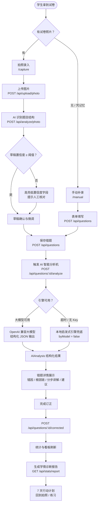
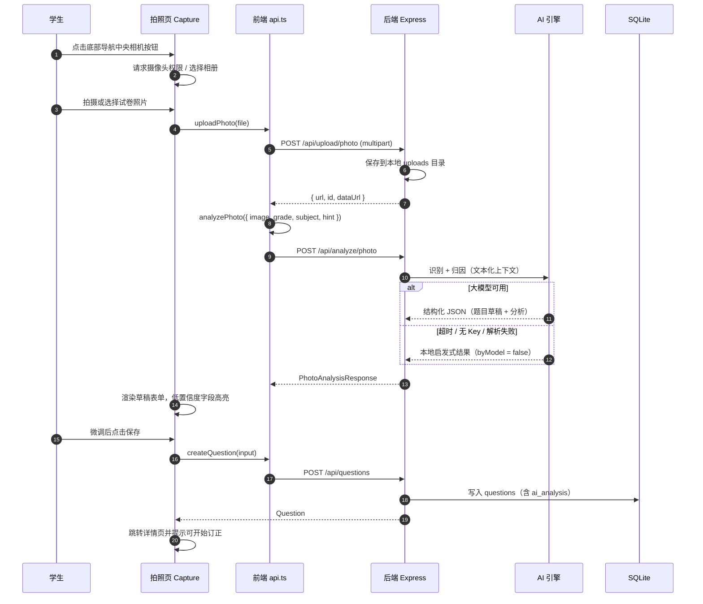
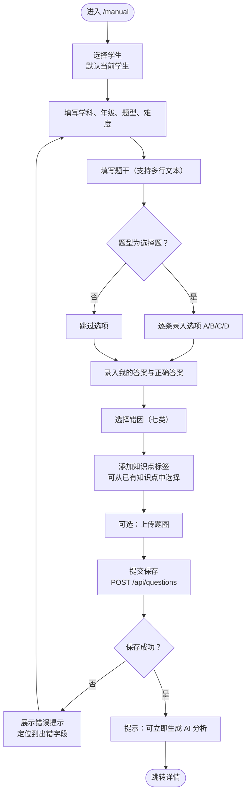
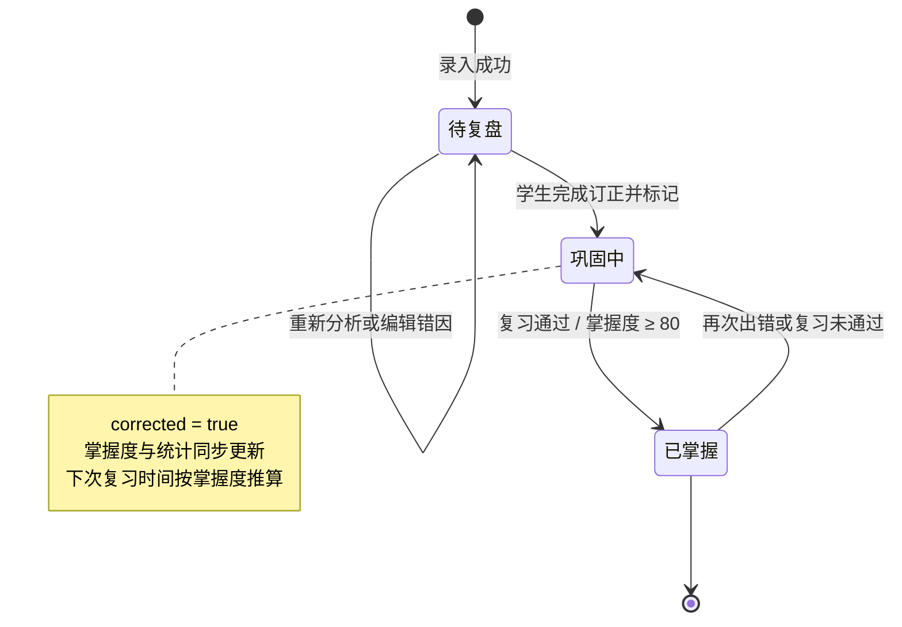
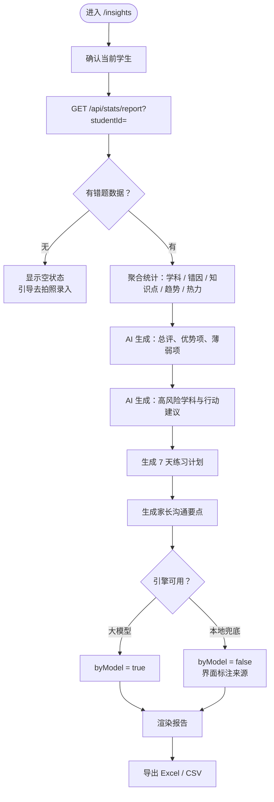
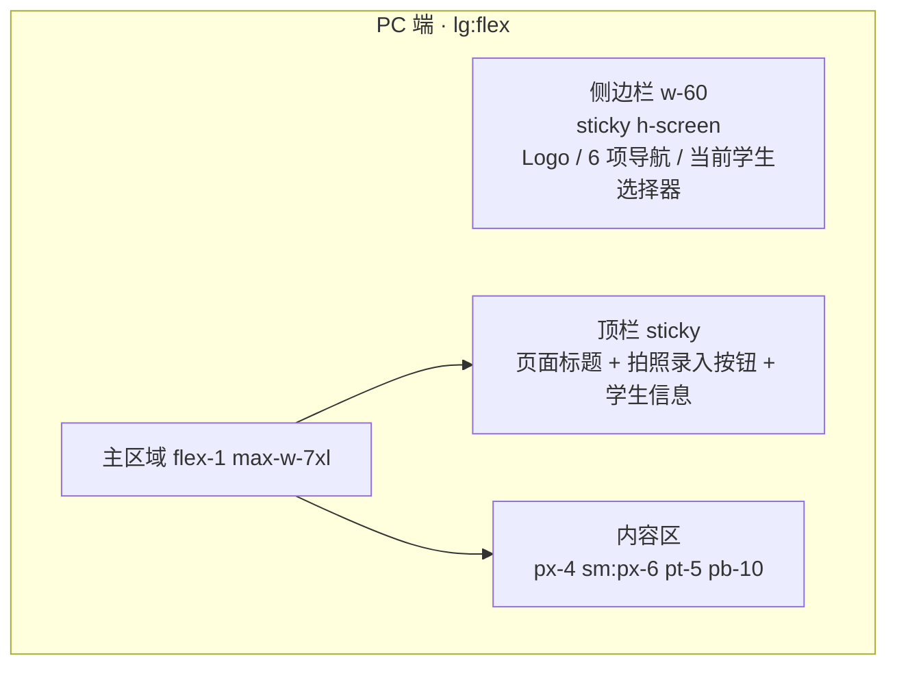
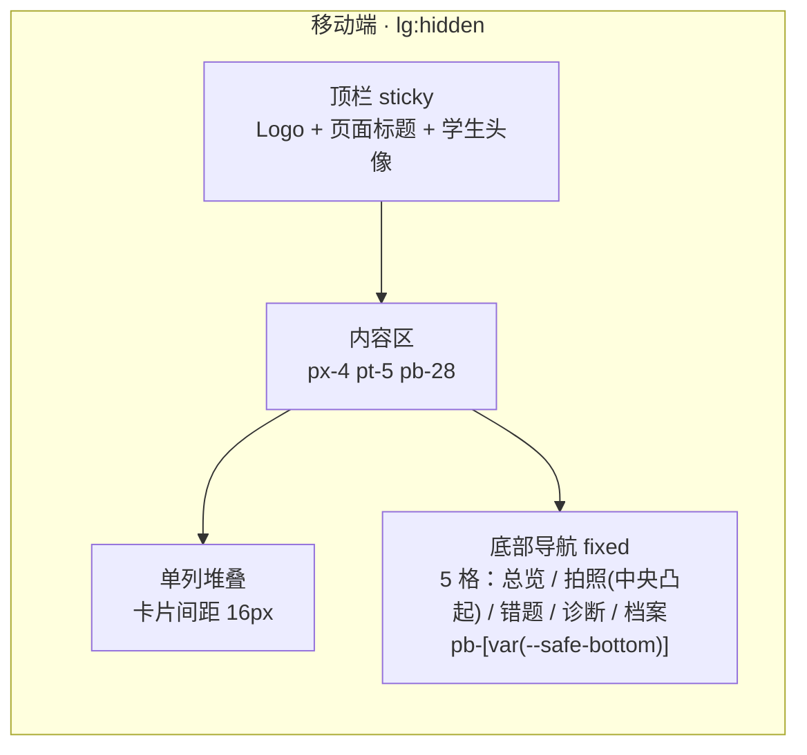

# 02 · 功能架构与信息架构

> 文档类型：功能架构说明书（Functional Architecture & IA）
> 版本：v1.0 ｜ 最后更新：2026-10-26
> 关联文档：[产品需求与痛点分析](./01-产品需求与痛点分析.md) ｜ [技术架构设计](./03-技术架构设计.md) ｜ [交互与视觉规范](./04-交互与视觉规范.md) ｜ [开发与部署指南](./05-开发与部署指南.md) ｜ [测试与验收清单](./06-测试与验收清单.md)

---

## 1. 功能模块树

> 分级口径：**P0 = MVP 必备**（缺失则产品不成立）；**P1 = 首个增强版本**；**P2 = 扩展**。
> 标注「待定/由后端约定」的部分表示接口形态已确定但具体实现细节由后端定义。

```mermaid
flowchart TD
    ROOT["错题本 · 学情智能分析系统"]

    ROOT --> M1["M1 采集层"]
    ROOT --> M2["M2 AI 分析层"]
    ROOT --> M3["M3 错题资产层"]
    ROOT --> M4["M4 统计分析层"]
    ROOT --> M5["M5 诊断报告层"]
    ROOT --> M6["M6 平台与体验层"]
    ROOT --> M7["M7 认证与权限层"]

    M1 --> M11["M1.1 拍照录入<br/>P0"]
    M1 --> M12["M1.2 图片上传<br/>P0"]
    M1 --> M13["M1.3 手动补录<br/>P0"]
    M1 --> M14["M1.4 草稿确认与微调<br/>P0"]

    M2 --> M21["M2.1 拍照 AI 识别<br/>P0"]
    M2 --> M22["M2.2 单题智能分析机<br/>P0"]
    M2 --> M23["M2.3 批量分析<br/>P1"]
    M2 --> M24["M2.4 大模型 / 本地双引擎<br/>P0"]

    M3 --> M31["M3.1 错题列表与筛选<br/>P0"]
    M3 --> M32["M3.2 错题详情<br/>P0"]
    M3 --> M33["M3.3 订正闭环与状态流转<br/>P0"]
    M3 --> M34["M3.4 学生档案管理<br/>P0"]
    M3 --> M35["M3.5 知识点体系维护<br/>P1"]

    M4 --> M41["M4.1 学情总览看板<br/>P0"]
    M4 --> M42["M4.2 学科分布<br/>P0"]
    M4 --> M43["M4.3 错因构成<br/>P0"]
    M4 --> M44["M4.4 知识点掌握雷达<br/>P0"]
    M4 --> M45["M4.5 掌握度趋势<br/>P0"]
    M4 --> M46["M4.6 活跃热力图<br/>P0"]
    M4 --> M47["M4.7 题型分布<br/>P0"]
    M4 --> M48["M4.8 优先突破知识点<br/>P0"]
    M4 --> M49["M4.9 多学生对比<br/>P1"]

    M5 --> M51["M5.1 AI 学情诊断报告<br/>P0"]
    M5 --> M52["M5.2 家长沟通要点<br/>P0"]
    M5 --> M53["M5.3 7 天行动计划<br/>P0"]
    M5 --> M54["M5.4 报告导出 PDF<br/>P1"]

    M6 --> M61["M6.1 PC 端宽屏看板 + 侧边栏<br/>P0"]
    M6 --> M62["M6.2 手机端底部导航 + 大按钮<br/>P0"]
    M6 --> M63["M6.3 摄像头直调<br/>P0"]
    M6 --> M64["M6.4 PWA 安装到桌面<br/>P0"]
    M6 --> M65["M6.5 Excel / CSV 导出<br/>P0"]
    M6 --> M66["M6.6 家长只读视图<br/>P1"]
    M6 --> M67["M6.7 家长授权与多账号<br/>P2"]

    M7 --> M71["M7.1 登录与会话<br/>P0"]
    M7 --> M72["M7.2 四级角色与 16 权限点<br/>P0"]
    M7 --> M73["M7.3 数据范围隔离<br/>P0"]
    M7 --> M74["M7.4 账号管理与关联学生<br/>P0"]
    M7 --> M75["M7.5 登录限流与会话吊销<br/>P0"]
    M7 --> M76["M7.6 统一身份认证 OIDC / LDAP<br/>P2"]

    ROOT --> M8["M8 系统设置与在线更新"]
    M8 --> M81["M8.1 系统设置入口（标签页）<br/>P0"]
    M8 --> M82["M8.2 AI 模型配置与连通性测试<br/>P0"]
    M8 --> M83["M8.3 账号管理与权限矩阵配置<br/>P0"]
    M8 --> M84["M8.4 在线更新（GitHub Release）<br/>P1"]
    M8 --> M85["M8.5 更新回滚与审计<br/>P1"]
```

### 1.1 模块清单与优先级说明

| 模块 | 优先级 | 核心能力 | 主要接口 | 页面归属 |
| --- | --- | --- | --- | --- |
| M1.1 拍照录入 | P0 | 调用摄像头/相册取图、预览、裁剪建议、重拍 | `POST /api/upload/photo` | `/capture` |
| M1.2 图片上传 | P0 | multipart 上传、返回 `url` / `id` / `dataUrl` | `POST /api/upload/photo` | `/capture` |
| M1.3 手动补录 | P0 | 表单录入学科/题型/知识点/题干/选项/答案/错因/难度 | `POST /api/questions` | `/manual` |
| M1.4 草稿确认与微调 | P0 | AI 草稿逐字段可改、低置信度字段提示 | `POST /api/questions` | `/capture`（识别结果页） |
| M2.1 拍照 AI 识别 | P0 | 图片 → 结构化草稿 + 完整 AI 分析 | `POST /api/analyze/photo` | `/capture` |
| M2.2 单题智能分析机 | P0 | 错因 + 置信度 + 根因链 + 分步讲解 + 缺口 + 建议 + 同类题 + 练习计划 | `POST /api/questions/:id/analyze` | `/questions/:id` |
| M2.3 批量分析 | P1 | 一次分析多题、队列化 | 待定/由后端约定 | `/questions` |
| M2.4 双引擎 | P0 | OpenAI 兼容大模型 + 本地启发式兜底，自动降级 | 由后端约定（`AI_*` 环境变量） | 全局 |
| M3.1 错题列表 | P0 | 多维筛选 + 分页 + 关键词 | `GET /api/questions` | `/questions` |
| M3.2 错题详情 | P0 | 全字段 + AI 分析 + 讲解 + 图片 | `GET /api/questions/:id` | `/questions/:id` |
| M3.3 订正闭环 | P0 | 标记订正、状态流转、掌握度、复习时间 | `POST /api/questions/:id/corrected`、`PATCH /api/questions/:id` | `/questions` `/questions/:id` |
| M3.4 学生档案 | P0 | 增删改查、年级/头像色/备注 | `/api/students` 系列 | `/students` |
| M3.5 知识点体系 | P1 | 知识点合并、重命名、体系化 | `GET /api/knowledge/points`（P0 只读） | P1 新增 |
| M4.1–M4.8 统计 | P0 | 7 个统计维度 + 总览指标块 | `GET /api/stats/overview` | `/` |
| M4.9 多学生对比 | P1 | 班级/多人横向对比 | 待定/由后端约定 | P1 新增 |
| M5.1–M5.3 报告 | P0 | 总评、优势/薄弱、高风险学科、行动建议、7 天计划、家长要点 | `GET /api/stats/report` | `/insights` |
| M5.4 报告 PDF | P1 | 报告转 PDF 便于家长留存 | 待定/由后端约定 | P1 |
| M6.1–M6.4 双端与 PWA | P0 | 响应式布局、底部导航、摄像头直调、manifest | `public/manifest.webmanifest` | 全局 |
| M6.5 导出 | P0 | xlsx / csv 明细导出 | `GET /api/stats/export` | `/` `/insights` |
| M6.6 家长只读视图 | P1 | 只读、可分享的家长入口 | 待定/由后端约定 | P1 |
| M6.7 家长授权与多账号 | P2 | 授权体系、账号与同步 | 待定/由后端约定 | P2 |
| M7.1 登录与会话 | P0 | 账号口令登录、scrypt 校验、Cookie 会话、滑动续期、注销 | `POST /api/auth/login`、`POST /api/auth/logout`、`GET /api/auth/me` | `/login` |
| M7.2 角色与权限点 | P0 | admin / teacher / parent / student 四级角色、16 个权限点矩阵 | `GET /api/auth/permissions` | `/system?tab=users`（矩阵预览） |
| M7.3 数据范围隔离 | P0 | 按 `parent_id` / `teacher_id` / `user_id` 过滤学生与错题，越权 403 | 各业务端点内建 | 全局 |
| M7.4 账号管理 | P0 | 账号增删改查、停用、重置口令、关联学生 | `/api/users` 系列 | `/system?tab=users`（仅管理员） |
| M7.5 限流与会话吊销 | P0 | 登录失败 5 次锁定 15 分钟；停用/改密即刻踢下线 | 由后端约定 | 全局 |
| M7.6 统一身份认证 | P2 | OIDC / LDAP 对接校内 IdP，身份与授权解耦 | 待定/由后端约定 | P2 |
| M4.10 今日复习 | P0 | 按掌握度与复习时间生成当日复习队列 | `GET /api/questions`（筛选） | `/review` |
| M6.8 模型与 OCR 设置 | P0 | AI 供应商配置、连通性测试、OCR 配置（仅管理员） | `/api/settings/*` | `/system?tab=ai`（仅管理员） |
| M8.1 系统设置入口 | P0 | 单一入口 + 三标签（AI / 账号 / 更新），按权限点决定标签是否渲染 | — | `/system?tab=ai\|users\|update` |
| M8.2 AI 模型配置 | P0 | 供应商预设、密钥三态（留空/掩码/新值）、连通性测试、保存生效链路 | `/api/settings/providers`、`/api/settings/ai`、`/api/settings/ai/test` | `/system?tab=ai` |
| M8.3 账号管理与矩阵 | P0 | 账号增删改查、停用、重置口令、关联学生、**权限矩阵配置**（勾选后立即生效） | `/api/users` 系列、`GET\|PUT /api/auth/permissions` | `/system?tab=users` |
| M8.4 在线更新 | P1 | 检查 GitHub Release、下载、校验、备份、覆盖、进度与日志 | `/api/system/update/*` | `/system?tab=update` |
| M8.5 更新回滚与审计 | P1 | 回滚到上次备份、更新历史（版本/时间/备份目录） | `POST /api/system/update/rollback` | `/system?tab=update` |

### 1.2 MVP 验收边界（P0 清单）

| 能力 | 判定标准 |
| --- | --- |
| 拍照录入 | 手机上完成"拍照 → 出现结构化草稿 → 保存成功"全流程，耗时 ≤ 20 秒（不含识别等待） |
| 手动补录 | 表单可提交并生成完整错题记录 |
| AI 智能分析 | 每道错题可产出七类错因之一 + 置信度 + 根因链 + 分步讲解 + 练习计划 |
| 统计看板 | 7 个统计维度全部有真实数据驱动（空数据时有明确空状态） |
| 订正闭环 | 标记订正后，掌握度、状态、统计口径同步变化 |
| 诊断报告 | 可生成含总评/优势/薄弱/风险/建议/计划/家长要点的完整报告 |
| 双端 | 375px 宽手机与 1440px 宽 PC 均可完整使用，无横向滚动 |
| 导出 | xlsx 可正常打开且含表头与明细 |
| 离线降级 | 未配置 `AI_API_KEY` 时全流程可用，报告明示来源 |
| 登录与鉴权 | 除 `/api/health` 与 `/api/auth/login` 外全部接口需登录；未登录 401，越权 403 |
| 数据隔离 | 家长/教师/学生账号只能看到各自范围内的学生与错题，导出内容同样受控 |

---

## 2. 端到端业务流程

### 2.1 主流程总览

### 2.2 拍照识别流程（细化）

### 2.3 手动补录流程

### 2.4 订正闭环流程

> 状态取值与前端枚举一致：`unreviewed`（待复盘）/ `learning`（巩固中）/ `mastered`（已掌握）；订正动作走 `POST /api/questions/:id/corrected`，字段级修改走 `PATCH /api/questions/:id`。

### 2.5 AI 诊断报告生成流程

### 2.6 统计刷新时机

| 触发动作 | 受影响的模块 |
| --- | --- |
| 新增 / 删除错题 | 学科分布、错因构成、题型分布、知识点掌握、热力图、趋势、总览计数 |
| 修改错因类型 | 错因构成、优先突破知识点排序 |
| 修改知识点标签 | 知识点掌握雷达、优先突破知识点、知识点引用计数 |
| 标记订正 / 改变状态 | 掌握度均值、订正率、已掌握计数、趋势线的 corrected 序列 |
| 修改日期（补录历史题） | 趋势、热力图、活跃天数 |

---

## 3. 信息架构

### 3.1 站点地图

```mermaid
flowchart TD
    HOME["/ 学情总览 Dashboard"]
    CAPTURE["/capture 拍照录入"]
    MANUAL["/manual 手动补录"]
    QUESTIONS["/questions 错题本"]
    DETAIL["/questions/:id 错题详情"]
    INSIGHTS["/insights AI 诊断"]
    STUDENTS["/students 学生档案"]
    REVIEW["/review 今日复习"]
    LOGIN["/login 登录"]
    SYSTEM["/system?tab=ai|users|update<br/>系统设置"]
    REDIR["旧路由重定向<br/>/settings → /system?tab=ai<br/>/users → /system?tab=users"]

    LOGIN --> LG1["账号 / 口令"]
    LOGIN --> LG2["4 个演示账号快捷登录"]
    LOGIN -.->|"登录成功"| GUARD{"ProtectedRoute"}
    GUARD -->|"已登录"| HOME
    GUARD -->|"未登录"| LOGIN

    SYSTEM --> T1["tab=ai · AI 模型"]
    SYSTEM --> T2["tab=users · 账号管理"]
    SYSTEM --> T3["tab=update · 系统更新"]

    T1 --> S1["AI 供应商与模型"]
    T1 --> S2["连通性测试"]
    T1 --> S3["OCR 配置"]

    T2 --> U1["账号列表"]
    T2 --> U2["新建 / 编辑 / 停用 / 删除"]
    T2 --> U3["重置口令"]
    T2 --> U4["关联学生"]
    T2 --> U5["权限矩阵配置表<br/>admin 列只读"]

    T3 --> V1["更新源配置（GitHub 仓库）"]
    T3 --> V2["检查新版本 / Release 说明"]
    T3 --> V3["一键更新：下载 → 校验 → 备份 → 覆盖"]
    T3 --> V4["进度与日志"]
    T3 --> V5["回滚到上次备份"]

    REDIR --> SYSTEM

    HOME --> W1["总览指标块<br/>题量 / 订正 / 活跃天数 / 掌握度 / 环比"]
    HOME --> W2["学科分布"]
    HOME --> W3["错因构成"]
    HOME --> W4["知识点掌握雷达"]
    HOME --> W5["掌握度趋势"]
    HOME --> W6["活跃热力图"]
    HOME --> W7["题型分布"]
    HOME --> W8["优先突破知识点"]
    HOME --> W9["最近录入"]

    CAPTURE --> C1["取景 / 相册"]
    CAPTURE --> C2["上传中"]
    CAPTURE --> C3["识别结果草稿"]
    CAPTURE --> C4["保存成功"]

    QUESTIONS --> Q1["筛选栏<br/>学生 / 学科 / 错因 / 状态 / 订正 / 知识点 / 关键词 / 日期"]
    QUESTIONS --> Q2["列表卡片"]
    QUESTIONS --> Q3["分页"]

    DETAIL --> D1["题目主体<br/>题干 / 选项 / 我的答案 / 正确答案"]
    DETAIL --> D2["AI 分析区<br/>错因 + 置信度 + 根因链 + 证据"]
    DETAIL --> D3["分步讲解"]
    DETAIL --> D4["知识点缺口 + 建议"]
    DETAIL --> D5["同类题推荐"]
    DETAIL --> D6["7 天练习计划"]
    DETAIL --> D7["订正操作区"]

    INSIGHTS --> I1["总评"]
    INSIGHTS --> I2["优势项 / 薄弱项"]
    INSIGHTS --> I3["高风险学科"]
    INSIGHTS --> I4["行动建议"]
    INSIGHTS --> I5["7 天计划"]
    INSIGHTS --> I6["家长沟通要点"]
    INSIGHTS --> I7["导出"]

    STUDENTS --> S1["学生列表"]
    STUDENTS --> S2["新建 / 编辑档案"]

    REVIEW --> R1["今日到期"]
    REVIEW --> R2["全部未掌握"]
    REVIEW --> R3["随机 10 题"]
```

### 3.2 路由与页面清单

| 路由 | 页面 | 职责 | 主要数据接口 |
| --- | --- | --- | --- |
| `/` | Dashboard（学情总览） | 汇总统计看板：指标块 + 7 个统计维度 + 优先突破清单 + 最近录入 | `GET /api/stats/overview` |
| `/capture` | Capture（拍照录入） | 拍照/相册 → 上传 → AI 识别 → 草稿微调 → 保存 | `POST /api/upload/photo`、`POST /api/analyze/photo`、`POST /api/questions` |
| `/manual` | Manual（手动补录） | 结构化表单录入；支持 `?copyFrom=<id>` **复制原题为新题**（保留题干/选项、清空答案） | `POST /api/questions`、`GET /api/knowledge/points` |
| `/questions` | WrongItems（错题本） | 多维筛选（**条件与 URL 双向同步，可分享/可回退**）、列表、分页、批量订正入口 | `GET /api/questions` |
| `/questions/:id` | ItemDetail（错题详情） | 全字段查看 + AI 分析 + 讲解 + 订正 + **再拍一张同类题**（跳转拍照并预填提示词） | `GET /api/questions/:id`、`PATCH /api/questions/:id`、`POST /api/questions/:id/analyze`、`POST /api/questions/:id/corrected` |
| `/review` | ReviewSession（今日复习） | 订正闭环训练场：按「今日到期 / 全部未掌握 / 随机 10 题」组题，逐题遮答案 → 对答案 → 标记订正，掌握度自动提升并安排下次复习 | `GET /api/questions`、`POST /api/questions/:id/corrected`、`POST /api/questions/:id/analyze` |
| `/insights` | Insights（AI 诊断） | 学情诊断报告（**学生角色不可见**：`report:read` 不含 student） | `GET /api/stats/report`、`GET /api/stats/export` |
| `/students` | Students（学生档案） | 学生增删改查 | `/api/students` 系列 |
| `/system?tab=ai` | System · AI 模型（**默认标签**） | AI 供应商/模型配置、连通性测试、OCR 配置（**仅管理员可见**） | `/api/settings/providers`、`/api/settings/ai`、`/api/settings/ai/test` |
| `/login` | Login（登录） | 账号口令登录、演示账号快捷登录、首次改密引导；**免登录路由** | `POST /api/auth/login` |
| `/system?tab=users` | System · 账号管理 | 账号增删改查、停用、重置口令、关联学生、**权限矩阵配置**（保存后立即生效，**仅管理员可见**） | `/api/users` 系列、`GET\|PUT /api/auth/permissions` |
| `/system?tab=update` | System · 系统更新 | 更新源配置、检查新版本、一键更新、进度与日志、回滚（**仅管理员可见**） | `/api/system/config`、`/api/system/update/*` |
| `/settings` | —（重定向） | 旧地址 → `/system?tab=ai` | — |
| `/users` | —（重定向） | 旧地址 → `/system?tab=users` | — |

> 路由兜底：未匹配路径由 `src/App.tsx` 的 `<Route path="*" element={<Navigate to="/" replace />} />` 重定向到 `/`。
>
> **登录态分支**：除 `/login` 外，所有路由都包在 `ProtectedRoute`（`src/features/auth/ProtectedRoute.tsx`）内 —— 启动时先 `GET /api/auth/me` 校验会话，未登录跳转 `/login` 并记录来源路径，登录后回跳。详见 [登录与分级权限设计](./08-登录与分级权限设计.md#82-路由守卫)。
>
> 另有**全局悬浮的「AI 智能分析机」助手**（`src/features/assistant/AssistantPanel.tsx`，右下角 🤖 入口），
> 不是独立路由：PC 端为右侧抽屉、手机端为底部面板，数据接口为 `POST /api/ai/chat`。

### 3.3 全局导航结构

导航项定义在 `src/components/layout/AppShell.tsx` 的 `NAV` 常量，PC 侧边栏与移动端底部导航共用同一份定义，仅展示项不同。

| 导航项 | 路由 | 完整标签 | 移动端短标签 | 图标 | PC 端 | 移动端 |
| --- | --- | --- | --- | --- | --- | --- |
| 学情总览 | `/` | 学情总览 | 总览 | 📊 | 侧边栏 | 底部导航 |
| 拍照录入 | `/capture` | 拍照录入 | — | 📷 | 侧边栏 | 底部**中央大按钮**（56px 凸起） |
| 手动补录 | `/manual` | 手动补录 | — | ✍️ | 侧边栏 | 不常驻（顶栏/页面入口可达） |
| 错题本 | `/questions` | 错题本 | 错题 | 📚 | 侧边栏 | 底部导航 |
| 今日复习 | `/review` | 今日复习 | 复习 | 🎯 | 侧边栏 + 顶栏按钮 | 底部导航 |
| AI 诊断 | `/insights` | AI 诊断 | 诊断 | 🤖 | 侧边栏 | 底部导航 |
| 学生档案 | `/students` | 学生档案 | — | 👦 | 侧边栏 | 顶栏头像点击进入 |
| 系统设置 | `/system` | 系统设置 | 设置 | ⚙️ | 侧边栏（**仅管理员**） | 顶栏用户菜单（仅管理员） |
| AI 助手 | —（悬浮） | AI 智能分析机 | — | 🤖 | 右下角悬浮球 | 右下角悬浮球 |
| 用户菜单 | —（浮层） | 头像 + 角色徽章 + 退出登录 | — | 👤 | 顶栏右上角 | 顶栏头像 |

**按权限过滤**：导航项的显示由权限点决定 —— 无 `settings:ai` / `users:manage` / `system:update` 任一权限的角色**看不到**「系统设置」入口（不置灰、不提示）。进入 `/system` 后，**标签页再按权限点二次过滤**：有 `settings:ai` 才渲染「AI 模型」标签，有 `users:manage` 才渲染「账号管理」，有 `system:update` 才渲染「系统更新」。判定来自 `useAuth().hasPermission`，服务端仍会独立鉴权。

**当前学生选择器**：PC 端固定在侧边栏底部；移动端在顶栏头像处展示当前学生姓名与年级。两个端共享同一状态（`src/store/app.tsx` 的 `AppProvider`），选择结果持久化在 `localStorage['cuoti.currentStudentId']`。

### 3.4 PC 端布局（≥ 1024px / `lg` 断点）

- **侧边栏**：宽 240px（`w-60`），白底半透明 + 背景模糊；Logo 区为 40px 圆角渐变方块（品牌蓝渐变）+「错题本 / 学情智能分析系统」双行标题。
- **顶栏**：高约 60px，吸顶；左侧显示当前页面标题（自动由路由匹配），右侧为「📷 拍照录入」主按钮与当前学生信息条。
- **内容区**：最大宽度 `max-w-7xl`（1280px），水平居中，桌面端底部留白 `pb-10`。
- **栅格建议**：指标块 4 列 → 2 列 → 1 列；图表区 3:2 或 1:1 两列，低于 `lg` 自动堆叠。

### 3.5 移动端布局（< 1024px）

- **底部导航**：固定于视口底部，5 列栅格；**中间为 56×56px 圆形/圆角渐变相机按钮**（`-mt-6` 凸起，带白色描边环），是拍照录入的唯一常驻入口。
- **安全区**：`padding-bottom: env(safe-area-inset-bottom)`，避免全面屏手势条遮挡。
- **内容留白**：`pb-28`（112px）确保最后一张卡片不被底栏遮住。
- **触控热区**：所有可点击元素最小 44×44px（详见 [交互与视觉规范](./04-交互与视觉规范.md#6-移动端适配与触控热区)）。

### 3.6 PWA 与安装入口

| 项 | 取值 | 来源 |
| --- | --- | --- |
| 名称 / 短名 | 错题本 · 学情智能分析系统 / 错题本 | `public/manifest.webmanifest` |
| 显示模式 | `standalone` | manifest |
| 方向 | `portrait-primary` | manifest |
| 主题色 / 背景色 | `#0f172a` / `#f5f7fb` | manifest + `index.html` |
| 快捷方式 | 「拍照录入错题」→ `/capture`；「学情分析报告」→ `/insights` | manifest `shortcuts` |
| iOS 适配 | `apple-mobile-web-app-capable` + `apple-touch-icon` | `index.html` |

---

## 4. 数据对象与页面映射

| 数据对象 | 来源接口 | 主要消费页面 | 关键字段（节选） |
| --- | --- | --- | --- |
| `Student` | `GET /api/students` | 全局（当前学生切换）、`/students` | `id` `name` `grade` `avatarColor` `school` `note` |
| `Question` | `GET /api/questions`、`GET /api/questions/:id` | `/questions` `/questions/:id` `/` | `subject` `questionType` `knowledgePoints` `stem` `options` `myAnswer` `correctAnswer` `errorType` `difficulty` `images` `mastery` `status` `corrected` |
| `AIAnalysis` | `POST /api/questions/:id/analyze`、`POST /api/analyze/photo` | `/questions/:id` `/capture` | `byModel` `diagnosis` `rootCauses` `correctSteps` `knowledgeGaps` `tips` `similarQuestions` `practicePlan` |
| `PhotoAnalysisResponse` | `POST /api/analyze/photo` | `/capture` | `draft`（含 `confidence`、`ocrText`）、`analysis` |
| `StatsOverview` | `GET /api/stats/overview` | `/` | `totals` `bySubject` `byKnowledge` `byErrorType` `byQuestionType` `trend` `heatmap` `weakPoints` `recent` |
| `InsightReport` | `GET /api/stats/report` | `/insights` | `summary` `strengths` `weaknesses` `riskSubjects` `suggestions` `weeklyPlan` `parentNotes` |
| `KnowledgePointRef` | `GET /api/knowledge/points` | `/manual` `/questions` | `name` `subject` `count` |
| `User` | `GET /api/auth/me`、`GET /api/users` | 全局（用户菜单）、`/users` | `id` `username` `name` `role` `status` `linkedStudentIds` `mustChangePassword` |
| `LoginResult` | `POST /api/auth/login`、`GET /api/auth/me` | 全局 | `user` + `permissions` |
| `PermissionMatrix` | `GET /api/auth/permissions` | `/system?tab=users`（矩阵预览） | 权限点 → 允许角色列表 |
| `SystemConfig` | `GET /api/system/config` | `/system?tab=update` | `repo` `autoRestart` `proxy` `hasToken` `tokenSource` `updatedAt?`（**不含 `token`**——令牌永不回显） |
| `UpdateInfo` | `GET /api/system/update/info` | `/system?tab=update` | `configured` `repo` `currentVersion` `latestVersion` `latestTag` `publishedAt` `notes` `hasUpdate` `prerelease` |
| `UpdateStatus` | `GET /api/system/update/status` | `/system?tab=update` | `state` `message` `progress` `log[]` `startedAt?` `finishedAt?` `newVersion?` `previousVersion?` `requiresRestart?` `error?` |

> 完整字段定义以 [`src/lib/types.ts`](../src/lib/types.ts) 为唯一数据契约，本文不复述细节，避免与代码漂移。

---

## 5. 状态流转与权限

### 5.1 错题状态机（与前端枚举一致）

| 状态 | 枚举值 | 含义 | 常见进入方式 | 退出方式 |
| --- | --- | --- | --- | --- |
| 待复盘 | `unreviewed` | 录入后尚未订正 | 录入成功 | 标记订正 / 直接编辑 |
| 巩固中 | `learning` | 已订正，仍需巩固 | 标记订正 | 掌握度提升至已掌握 / 再次出错回落 |
| 已掌握 | `mastered` | 复习通过 | 掌握度 ≥ 80 或人工调整 | 再次出错回到巩固中 |

### 5.2 权限边界（角色 × 数据范围）

系统已从"单设备可信、无账号"演进为**四级角色 + 数据范围隔离**：

| 角色 | 功能权限（摘要） | 数据范围 |
| --- | --- | --- |
| `admin` 系统管理员 | 全部权限，唯一可改 AI/OCR 设置与管理账号 | 全部学生 |
| `teacher` 教师 | 所授学生的错题/统计/报告/导出；可改学生档案；不可管账号与设置 | `students.teacher_id = 当前账号` |
| `parent` 家长 | 自己孩子的错题/统计/报告/导出；不可删学生、不可看别人孩子 | `students.parent_id = 当前账号` |
| `student` 学生 | 自己的错题本、统计、今日复习、录入与订正；**不看报告、不导出** | `students.user_id = 当前账号` |

- **未登录 401**（会话缺失/失效），**越权 403**（权限点不足或数据越权），两者语义不同。
- 除 `/api/health` 与 `/api/auth/login` 外，所有 `/api/*` 均需登录。
- 前端守卫（`ProtectedRoute` / `PermissionGate`）只负责体验，**安全边界在服务端**。

> 完整权限矩阵、数据范围判定规则与会话机制见 [登录与分级权限设计](./08-登录与分级权限设计.md)。

---

## 6. 异常与边界流程

| 场景 | 系统行为 |
| --- | --- |
| 拍照识别超时 | 前端提示"识别超时，可手动补录"，保留已上传图片，一键跳转 `/manual` 并预填学科/年级 |
| 识别结果字段缺失（如无选项） | 草稿中该字段留空并标注"待确认"，不阻断保存 |
| 草稿置信度低 | 相关字段高亮 + "请核对"提示；保存后在详情页标注低置信度分析 |
| 大模型不可用 | 自动切换本地启发式引擎，`AIAnalysis.byModel = false`，界面以标签明示"本地引擎生成" |
| AI 分析整体失败 | 详情页显示"分析失败，可重试"并保留重试按钮，不影响错题本身的查看与订正 |
| 保存接口失败 | Toast 报错并保留表单内容，不清空用户输入 |
| 目标学生被删除 | 当前学生选择器自动回落到列表首位；其错题保留在库中（`student_id` 指向已删除 ID） |
| 无任何错题 | 所有统计与报告显示明确空状态 + 引导按钮，不显示 `NaN` 或空白图表 |

---

## 7. 关联文档

- [01 · 产品需求与痛点分析](./01-产品需求与痛点分析.md) —— 本文档的模块优先级如何对应用户价值与 MVP 边界
- [03 · 技术架构设计](./03-技术架构设计.md) —— 各模块对应的接口、数据库表与 AI 引擎实现
- [04 · 交互与视觉规范](./04-交互与视觉规范.md) —— 双端布局的具体尺寸、间距与图表使用规则
- [06 · 测试与验收清单](./06-测试与验收清单.md) —— 本文档每条流程的验收用例
- [08 · 登录与分级权限设计](./08-登录与分级权限设计.md) —— 四级角色、16 权限点、数据范围隔离与登录态分支
- [09 · 系统设置与在线更新](./09-系统设置与在线更新.md) —— `/system` 三标签的职责边界、更新流程与安全边界
