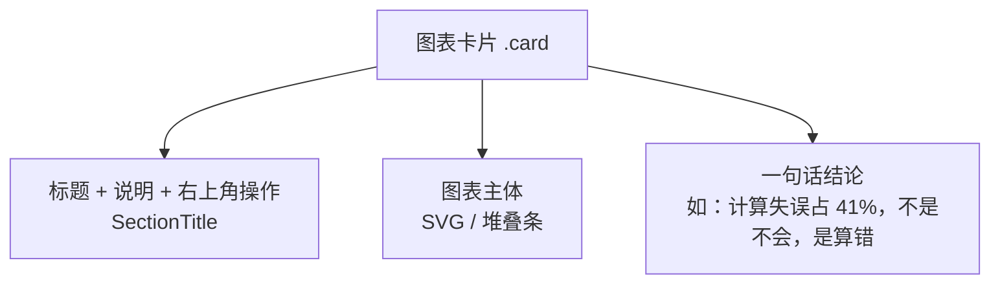
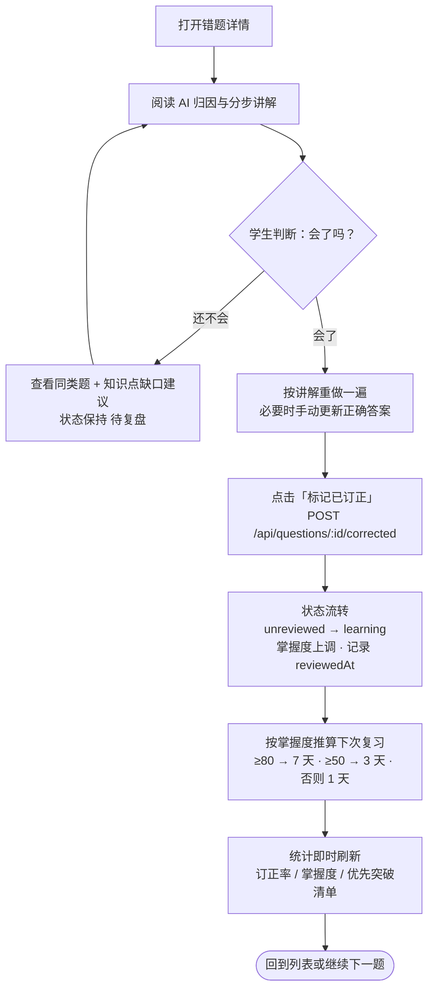

# 04 · 交互与视觉规范

> 文档类型：设计规范（Design System & Interaction Spec）
> 版本：v1.0 ｜ 最后更新：2026-10-26
> 关联文档：[产品需求与痛点分析](./01-产品需求与痛点分析.md) ｜ [功能架构与信息架构](./02-功能架构与信息架构.md) ｜ [技术架构设计](./03-技术架构设计.md) ｜ [开发与部署指南](./05-开发与部署指南.md) ｜ [测试与验收清单](./06-测试与验收清单.md)

> **实施依据**：本文中的色值、字号、圆角、阴影均取自 [`src/styles.css`](../src/styles.css) 的 `@theme` 块与工具类，语义色取自 [`src/lib/format.ts`](../src/lib/format.ts) 与 [`src/lib/types.ts`](../src/lib/types.ts)。改动设计令牌时必须同步本文档。

---

## 1. 设计原则

| # | 原则 | 含义 | 在本项目中的体现 |
| --- | --- | --- | --- |
| **P1** | **一次一屏，一屏一事** | 每个页面只承载一个主要任务，辅助信息折叠或下沉 | 拍照页只有"取景—识别—保存"三步；诊断页按结论→证据→计划→家长要点顺序线性排布 |
| **P2** | **默认路径最短** | 最常用的动作必须是零思考、零跳转的 | 拍照按钮常驻底部导航中央；AI 分析结果直接内嵌详情页，不跳新页面 |
| **P3** | **不确定就诚实** | AI 输出必须标明来源与置信度，不伪装确定 | `byModel` 标签、"本地引擎生成"角标、低置信度字段高亮 |
| **P4** | **正向反馈即时** | 每次操作都要有可见回应 | 订正后掌握度与统计即时刷新；Toast 提示；动画 `fade-up` / `pop-in` |
| **P5** | **移动端优先但不做残废版** | 手机端是主战场，但 PC 端要能承载"看数据" | 响应式栅格 + 侧边栏/底栏切换 + 图表自适应宽度 |
| **P6** | **少即是多** | 每屏视觉元素不超过必要量 | 统计区用统一的 `StatTile` + 图表卡，不叠加装饰性图形 |
| **P7** | **家长友好** | 面向家长的内容避免术语堆砌 | 诊断报告用"计算失误占 41%——不是不会，是算错"的表述 |

### 1.1 语气与文案

| 场景 | 写法 | 反例 |
| --- | --- | --- |
| 成功 | "已保存，可在错题本查看" | "操作成功" |
| 失败 | "识别超时，可手动补录" | "请求失败 (500)" |
| AI 结论 | "AI 判断：知识盲点（置信度 78%）" | "该题错误" |
| 引导 | "拍一张照片，30 秒录入这道错题" | "请上传图片" |
| 空状态 | "还没有错题记录" + 一个明确按钮 | 空白页 / "No Data" |

---

## 2. 配色令牌

### 2.1 品牌色（Brand）

用于主按钮、选中态、品牌标识、渐变。

| 令牌 | 色值 | 用途 |
| --- | --- | --- |
| `--color-brand-50` | `#eef4ff` | 浅底（选中态背景、标签底色） |
| `--color-brand-100` | `#dbe6ff` | 标签底色、浅色环 |
| `--color-brand-200` | `#bed1ff` | 悬停边框、卡片描边高亮 |
| `--color-brand-300` | `#91b0ff` | 输入框聚焦边框 |
| `--color-brand-400` | `#5c85fb` | 输入框聚焦环、浅色图标 |
| `--color-brand-500` | `#3b63f6` | **品牌主色**：图标底色、图表默认色 |
| `--color-brand-600` | `#2747eb` | **主按钮底色**（`.btn-primary`） |
| `--color-brand-700` | `#1f35d7` | 主按钮悬停 |
| `--color-brand-800` | `#1e2daf` | 深色文字强调 |
| `--color-brand-900` | `#1e2c8a` | 极深强调 |

### 2.2 中性色（Ink）

用于文字、边框、背景层次。

| 令牌 | 色值 | 用途 |
| --- | --- | --- |
| `--color-ink-50` | `#f8fafc` | 次级区块底 |
| `--color-ink-100` | `#f1f5f9` | 分隔线、标签底、骨架屏底 |
| `--color-ink-200` | `#e2e8f0` | 卡片边框、输入框边框 |
| `--color-ink-300` | `#cbd5e1` | 坐标轴线、滚动条滑块 |
| `--color-ink-400` | `#94a3b8` | 辅助文字、占位符、坐标轴刻度 |
| `--color-ink-500` | `#64748b` | 次要说明文字、字段标签 |
| `--color-ink-600` | `#475569` | 正文次级 |
| `--color-ink-700` | `#334155` | 正文、按钮文字（outline） |
| `--color-ink-800` | `#1e293b` | **正文主色** |
| `--color-ink-900` | `#0f172a` | 标题、强调数值 |

### 2.3 语义色（状态与反馈）

| 语义 | 色值 | 使用场景 |
| --- | --- | --- |
| 成功 / 上升 | `#10b981`（emerald-500） | 掌握度提升、订正完成、环比上升 `▲` |
| 危险 / 下降 | `#ef4444`（red-500） | 删除按钮底、环比下降 `▼`、高风险项 |
| 警告 | `#f59e0b`（amber-500） | 低置信度提示、需注意项 |
| 信息 | `#3b82f6`（blue-500） | 中性信息、默认图表色 |
| 中性占位 | `#64748b` | 未知学科/类型的兜底色 |

> 涨跌对比统一使用 `StatTile` 内的 `▲/▼ + 百分比` 形式：上升 emerald-600，下降 red-500，**颜色之外同时使用箭头符号**，避免仅靠颜色传达信息（无障碍要求）。

### 2.4 学科色（Semantic — Subject）

`src/lib/format.ts` 中 `SUBJECT_COLOR` 定义图表色，`SUBJECT_BG` 定义标签底色：

| 学科 | 图表色 | 标签样式 |
| --- | --- | --- |
| 语文 | `#ef4444` | `bg-red-50 text-red-700 ring-red-200` |
| 数学 | `#3b82f6` | `bg-blue-50 text-blue-700 ring-blue-200` |
| 英语 | `#10b981` | `bg-emerald-50 text-emerald-700 ring-emerald-200` |
| 物理 | `#8b5cf6` | `bg-violet-50 text-violet-700 ring-violet-200` |
| 化学 | `#f59e0b` | `bg-amber-50 text-amber-700 ring-amber-200` |
| 生物 | `#14b8a6` | `bg-teal-50 text-teal-700 ring-teal-200` |
| 地理 | `#0ea5e9` | `bg-sky-50 text-sky-700 ring-sky-200` |
| 历史 | `#a16207` | `bg-yellow-50 text-yellow-800 ring-yellow-200` |
| 政治 | `#db2777` | `bg-pink-50 text-pink-700 ring-pink-200` |
| 道法 | `#db2777` | `bg-pink-50 text-pink-700 ring-pink-200` |

> 兜底色（未列出的学科）：`#64748b`。政治与道法共用粉色属**有意为之**（同属道德与法治范畴），但图表中建议用文字标签区分。

### 2.5 错因色（Error Type）

`src/lib/types.ts` 的 `ERROR_TYPE_COLOR` 定义，**同一错因在所有图表中必须使用同一颜色**：

| 错因 | 枚举值 | 色值 | 说明 |
| --- | --- | --- | --- |
| 知识盲点 | `knowledge_gap` | `#ef4444` | 概念/公式/定理未掌握 |
| 审题不清 | `misread` | `#f59e0b` | 题意理解偏差 |
| 计算失误 | `calculation` | `#3b82f6` | 思路对、运算错 |
| 方法不当 | `method` | `#8b5cf6` | 解题方向错误 |
| 时间不足 | `time` | `#06b6d4` | 会做但没做完 |
| 粗心大意 | `careless` | `#ec4899` | 看错符号、抄错数字 |
| 书写不规范 | `expression` | `#84cc16` | 步骤缺失、单位不规范 |

### 2.6 背景与表面

| 用途 | 实现 |
| --- | --- |
| 页面背景 | `#f6f8fc` + 两层径向渐变（`#e8efff` 右上、`#f0f7ff` 左上） |
| 卡片表面 | `rgb(255 255 255 / 0.92)` + 1px `rgb(226 232 240 / 0.9)` 边框 + `backdrop-filter: blur(6px)` |
| 顶栏/底栏 | `rgb(255 255 255 / 0.85–0.95)` + `backdrop-blur` |
| PWA 主题色 | `#0f172a`（`theme-color`） |
| PWA 背景色 | `#f5f7fb`（`background_color`） |

---

## 3. 排版、间距、圆角与阴影

### 3.1 字号阶梯

| 层级 | Tailwind 类 | 字号 | 字重 | 用途 |
| --- | --- | --- | --- | --- |
| 展示 | `text-3xl` | 30px | `font-black` | `StatTile` 主数值 |
| 页面标题 | `text-base`（移动 `text-sm`） | 16 / 14px | `font-black` | 顶栏标题 |
| 区块标题 | `text-sm` | 14px | `font-bold` | `SectionTitle` |
| 正文 | 默认 | 16px | 400 | 题目正文、讲解段落 |
| 紧凑正文 | `text-xs` | 12px | 600 | 列表项说明、表单标签 |
| 辅助 | `text-[11px]` | 11px | 400–700 | 时间戳、来源说明 |
| 微文字 | `text-[10px]` | 10px | `font-bold` | 底部导航短标签、图表刻度 |

**规则**：

- 移动端正文不小于 14px；图表刻度与徽标可降至 10px。
- 标题使用 `tracking-tight`（字间距收紧），正文不加字距。
- 中文字体栈：`'PingFang SC', 'Hiragino Sans GB', 'Microsoft YaHei', 'Noto Sans SC', system-ui, -apple-system, 'Segoe UI', Roboto, sans-serif`。
- 行高：正文默认 1.5；`.textarea` 固定 `line-height: 1.6`；题干与讲解段落建议 1.75。

### 3.2 间距阶梯

基于 Tailwind 默认 4px 栅格：

| 语义 | 值 | 类 | 用途 |
| --- | --- | --- | --- |
| 极小 | 4px | `gap-1` | 图标与文字、标签内间距 |
| 小 | 8px | `gap-2` | 按钮内元素、徽标间距 |
| 中 | 12px | `gap-3` | 顶栏元素、卡片内小节 |
| 标准 | 16px | `gap-4` / `p-4` | 卡片内边距基准、栅格间距 |
| 大 | 24px | `gap-6` / `p-6` | 卡片外留白、章节分隔 |
| 特大 | 32px | `gap-8` | 页面级区块间距 |

**布局常量**：

| 项 | 值 |
| --- | --- |
| 页面左右留白 | 移动 16px（`px-4`）→ ≥ 640px 24px（`sm:px-6`） |
| 顶栏高度 | 60px（`py-3` + 36px 内容） |
| 内容最大宽度 | `max-w-7xl` = 1280px |
| 内容底部留白 | 移动 112px（`pb-28`，避让底栏）→ 桌面 40px（`lg:pb-10`） |
| 卡片圆角 | 16px（`.card` → `border-radius: 1rem`） |
| 卡片内边距 | 16–24px（`p-4` / `p-6`） |

### 3.3 圆角

| 圆角 | 值 | 类 | 用途 |
| --- | --- | --- | --- |
| 小 | 8px | `rounded-lg` | 小图标底、输入框（0.65rem ≈ 10px） |
| 中 | 12px | `rounded-xl` | 按钮、导航项、头像、Tab 容器 |
| 大 | 16px | `rounded-2xl` | 中央拍照按钮、卡片（`1rem`） |
| 全圆 | 999px | `rounded-full` | 标签（`.tag`）、进度条、滚动条 |

### 3.4 阴影

| 令牌 | 值 | 用途 |
| --- | --- | --- |
| `--shadow-card` | `0 1px 2px rgb(15 23 42 / 0.04), 0 8px 24px -12px rgb(15 23 42 / 0.12)` | 卡片默认 |
| `--shadow-pop` | `0 10px 40px -12px rgb(15 23 42 / 0.28)` | 卡片悬停、弹层 |
| `.btn-primary` | `0 6px 18px -8px rgb(39 71 235 / 0.7)` | 主按钮 |
| 拍照按钮 | `shadow-lg shadow-brand-600/35` + `ring-4 ring-white` | 底部导航中央凸起按钮 |
| Logo 方块 | `shadow-lg shadow-brand-500/25` | 侧边栏标识 |

### 3.5 动效

| 动效 | 时长 | 缓动 | 用途 |
| --- | --- | --- | --- |
| `fade-up` | 280ms | `ease` | 卡片/列表入场（位移 8px + 透明度） |
| `pop-in` | 180ms | `ease` | 弹层、徽标出现（缩放 0.96 → 1） |
| `shimmer` | 1.4s 循环 | `linear` | 骨架屏/加载占位 |
| 按钮按下 | 100ms | `ease` | `transform: scale(0.98)` |
| 卡片悬停 | 180ms | `ease` | 上移 2px + 阴影加深 |
| 图表数值条 | 700ms | `ease` | 横向条形图宽度增长 |

> **无障碍要求**：系统开启"减少动态效果"（`prefers-reduced-motion: reduce`）时，所有动画与过渡自动降为 0.01ms（已在 `styles.css` 中实现）。

### 3.6 基础组件清单

| 组件 | 来源 | 关键参数 | 使用场景 |
| --- | --- | --- | --- |
| `Card` | `src/components/ui` | — | 所有内容区块外壳 |
| `Badge` | 同上 | — | 学科/错因/状态标签 |
| `StatTile` | 同上 | `label` `value` `unit` `delta` `hint` `icon` `accent` | 看板指标块 |
| `Progress` | 同上 | `value` `color` `height`(默认 8) | 掌握度条 |
| `Avatar` | 同上 | `name` `color` `size` | 学生头像（取姓名前两字） |
| `EmptyState` | 同上 | — | 无数据占位 |
| `Skeleton` / `Spinner` | 同上 | — | 加载态 |
| `Modal` | 同上 | — | 确认弹窗、表单弹层 |
| `Tabs` | 同上 | `tabs[{key,label,count}]` `value` `onChange` | 筛选维度切换 |
| `AlertBox` | 同上 | — | 提示、警告、低置信度说明 |
| `Field` | 同上 | — | 表单字段（标签 + 控件 + 错误） |
| `SectionTitle` | 同上 | — | 区块标题 |
| `ToggleRow` | 同上 | — | 开关型设置行 |

**按钮变体**：`.btn`（基础） + `.btn-primary` / `.btn-outline` / `.btn-ghost` / `.btn-danger`；尺寸 `.btn-sm`（0.8rem） / 默认（0.875rem） / `.btn-lg`（1rem）。
**表单控件**：`.input` / `.select` / `.textarea`；聚焦态为 `border-brand-400` + `3px rgb(59 99 246 / 0.14)` 外发光。

> **【实现约束】自定义类必须放进 `@layer components`**
>
> `.tag` / `.btn` / `.label` 等自定义类若写成**无层级 CSS**，按 CSS 规范其优先级**高于** Tailwind 工具类（同为单类选择器时，无层级样式胜出），于是 `class="tag hidden md:inline-flex"` 里的 `hidden` **永远不生效**——元素该隐藏时仍显示。
>
> | 项 | 规定 |
> | --- | --- |
> | 写法 | 所有自定义类一律写在 `src/styles.css` 的 `@layer components { … }` 内（`@layer base` 放元素级基础样式） |
> | 后果 | Tailwind 工具类（`hidden` `flex` `md:inline-flex` 等）优先级高于自定义类，工具类可正常覆盖 |
> | 判据 | **自定义类只负责"长什么样"，显隐与布局交给工具类** |
>
> 该问题曾导致手机端顶栏横向溢出 65px（`hidden` 失效导致元素仍在参与布局），修复后溢出消失。**新增自定义类时必须同步放进 `@layer components`**，否则会重蹈覆辙。

---

## 4. 布局规范

### 4.1 断点

| 断点 | Tailwind | 宽度 | 布局变化 |
| --- | --- | --- | --- |
| 基础 | — | < 640px | 单列堆叠；底部导航；内容 `px-4`、`pb-28` |
| `sm` | `sm:` | ≥ 640px | 水平留白 24px；顶栏显示副标题与拍照按钮 |
| `md` | `md:` | ≥ 768px | 双列栅格（指标块 2 列） |
| `lg` | `lg:` | ≥ 1024px | **侧边栏出现、底部导航隐藏**；内容 `pb-10`；指标块 4 列；图表两列 |
| `xl` | `xl:` | ≥ 1280px | 保持 `max-w-7xl` 居中，不再加宽 |

### 4.2 双端结构差异

| 区域 | PC（≥ 1024px） | 手机（< 1024px） |
| --- | --- | --- |
| 导航 | 左侧固定 240px 侧边栏（6 项 + 当前学生选择器） | 底部 5 格导航，中央凸起拍照按钮 |
| 顶栏 | 页面标题 + 副标题 + 「📷 拍照录入」按钮 + 学生信息 | Logo + 页面标题 + 学生头像 |
| 标题字号 | `text-base` | `text-sm` |
| 内容宽度 | `max-w-7xl` 居中 | 100% 宽 |
| 栅格 | 指标 4 列 / 图表 2 列 | 全部单列 |
| 学生选择 | 侧边栏下拉框 | 顶栏头像区域 |
| 安全区 | 不需要 | `padding-bottom: env(safe-area-inset-bottom)` |

---

## 5. 图表规范

### 5.1 选型决策表

| 想知道的问题 | 使用图表 | 组件 | 理由 |
| --- | --- | --- | --- |
| 各学科错题有多少？ | **柱状图**（横向条形更好） | `BarChart horizontal` | 类别名较长、需要比较大小 |
| 错因构成占比多少？ | **环形图** | `DonutChart` | 类别 ≤ 7、强调"整体中的份额" |
| 掌握度随时间怎么变？ | **折线图** | `LineChart` | 连续时间序列、看趋势与拐点 |
| 各知识点掌握是否均衡？ | **雷达图** | `RadarChart` | 多维能力画像、突出短板 |
| 整体掌握度是多少？ | **仪表盘** | `Gauge` | 单值 + 0–100 区间 |
| 哪天做题最多？ | **热力图** | `Heatmap` | 时间 × 频率、发现活跃规律 |
| 题目构成（按学科/题型） | **堆叠条** | `StackedBar` | 轻量占比、无需坐标轴 |
| 排名（如 Top 薄弱知识点） | **横向条形图** | `BarChart horizontal` | 排序一目了然 |

### 5.2 使用规则

| 规则 | 说明 |
| --- | --- |
| **类别 ≤ 12 才用柱状图** | 超过 12 项改用横向条形（Top N）并标注"仅显示前 N 项" |
| **环形图只用于 2–7 类** | 类别过少（1 类）用数字卡片代替；过多用条形图 |
| **颜色语义固定** | 学科用学科色，错因用错因色，掌握度用品牌蓝→红的高低位渐变；**同一实体在任何图表中颜色一致** |
| **坐标轴从 0 起** | 柱状图纵轴基线为 0，不允许截断造成误导 |
| **数值直接标注** | 柱顶标数值，条形右侧标数值，不强制用户读刻度 |
| **类别名 ≤ 5 字** | 超过自动截断为 `xxxx…`，完整名放在 `<title>` 悬浮提示中 |
| **空数据有状态** | 无数据时显示 `EmptyState`，不渲染空坐标系的 SVG |
| **图表必须有文本替代** | SVG 容器带 `role="img"`，关键结论在卡片标题中以文字复述 |
| **响应式** | 图表宽度由 `useMeasure`（`ResizeObserver`）驱动，容器变化即重绘 |
| **动画克制** | 只在首次渲染或数据变化时做 700ms 增长动画，不做循环动效 |

### 5.3 图表卡片结构

> **强制要求**：每个统计卡片底部必须有一句**人话结论**。只给图不给结论，等于把分析工作推回给用户，与 [产品需求 §1.1](./01-产品需求与痛点分析.md#11-设计哲学三句话) 的 P3 冲突。

### 5.4 图表与数据源对应

| 图表 | 数据字段 |
| --- | --- |
| 学科分布 | `StatsOverview.bySubject` |
| 错因构成 | `StatsOverview.byErrorType`（`count` / `ratio`） |
| 题型分布 | `StatsOverview.byQuestionType` |
| 知识点掌握雷达 | `StatsOverview.byKnowledge`（取 `mastery`，限制 6–8 个维度） |
| 掌握度趋势 | `StatsOverview.trend`（`date` / `mastery` / `corrected`） |
| 活跃热力图 | `StatsOverview.heatmap`（`date` / `count`，默认 14 周） |
| 优先突破知识点 | `StatsOverview.weakPoints`（`name` / `mastery` / `severity`） |
| 整体掌握度 | `StatsOverview.totals.mastery` → `Gauge` |
| 指标块 | `StatsOverview.totals`（`questions` `corrected` `activeDays` `mastery` `masteryDelta` `questionDelta`） |

---

## 6. 移动端适配与触控热区

| 规则 | 数值 |
| --- | --- |
| 最小可点击区域 | **44 × 44 px**（Apple HIG / Material 建议值） |
| 底部导航项 | 约 64px 高、图标 18–24px、文字 10px |
| 中央拍照按钮 | **56 × 56 px**（`h-14 w-14`），上浮 24px（`-mt-6`） |
| 主操作按钮 | 移动端高度 ≥ 48px（`.btn-lg`） |
| 输入框 | 高度 ≥ 44px，字体 ≥ 16px（避免 iOS 聚焦时自动放大页面） |
| 列表项点击区 | 整行可点（`py-3` 以上），不只文字可点 |
| 图表点击 | 热力图单元格最小 12px；扇区/柱体命中区域不小于 24px |
| 手势冲突 | 横向滑动区域不与浏览器返回手势冲突；卡片上禁止横向滑动 |
| 双击缩放 | `maximum-scale=1.0, user-scalable=no`（已实现，保证底栏可用） |

**移动端内容顺序原则**：把"拍照录入"放在视觉第一屏，把"统计与诊断"放在次要位置——**学生端先做录入，家长端先看结论**。

---

## 7. 无障碍要点

| 维度 | 要求 | 实现要点 |
| --- | --- | --- |
| **语义化** | 使用 `header` / `nav` / `main` / `section` / `footer` 标签 | `AppShell` 已按此结构组织 |
| **图片替代** | 所有 `` 必须有 `alt`；装饰性图标标 `aria-hidden` | 图表 SVG 使用 `role="img"` 并配合可见文字结论 |
| **可访问名称** | 图标按钮必须有 `aria-label` | 如中央拍照按钮 `aria-label="拍照录入"` |
| **键盘可达** | 所有可交互元素可 Tab 聚焦，`:focus-visible` 有明显轮廓 | 下拉、弹窗、Tab 组件均使用原生可聚焦元素 |
| **焦点管理** | 弹窗打开时焦点进入弹窗，关闭后回到触发元素 | `Modal` 组件需保持（**具体实现待定/由后端约定**） |
| **对比度** | 正文与背景对比度 ≥ 4.5:1，大字 ≥ 3:1 | `ink-800` on 白 = 高对比；`ink-400` 仅用于 ≥ 14px 的辅助信息 |
| **不靠颜色传达** | 涨跌用 `▲/▼`，状态用文字标签 | `StatTile` 已同时使用箭头与颜色 |
| **对比度可调** | 尊重系统深色/高对比设置 | MVP 为浅色主题（`color-scheme: light`），**深色主题为 P1** |
| **减少动效** | 尊重 `prefers-reduced-motion` | `styles.css` 已全局降级 |
| **表单错误** | 错误信息与字段关联，可用读屏识别 | `Field` 组件承载标签、控件与错误文案 |
| **触控反馈** | 按下有视觉反馈 | `.btn:active { transform: scale(0.98) }` |
| **时间表达** | 同时给绝对时间与相对时间 | `formatDate`（10月26日）+ `fromNow`（2天前） |

---

## 8. 关键页面交互说明

### 8.1 拍照录入三步法

#### 第 1 步：取景（目标 ≤ 5 秒）

| 要素 | 规范 |
| --- | --- |
| 入口 | ① 底部导航中央 56px 相机按钮（移动端主入口）；② 顶栏「📷 拍照录入」按钮（PC 端）；③ PWA 快捷方式 |
| 相机 | 优先调起系统相机（`capture="environment"`）；提供"从相册选择"作为备选（试卷已拍照的情况）；桌面端另支持**拖拽**与**粘贴**图片 |
| 拍摄建议 | 画面中提示"尽量拍全、避免阴影与反光"；一张可拍 1–3 道题 |
| 预览 | 拍后立即显示缩略图，提供"重拍 / 裁剪（**待定**）/ 下一步" |
| 进度 | 上传中显示进度与"识别中"文案，允许取消 |

#### 第 2 步：识别（目标 ≤ 40 秒）

| 要素 | 规范 |
| --- | --- |
| 请求 | 先 `POST /api/upload/photo` 拿 `url`/`dataUrl`，再 `POST /api/analyze/photo`；识别前可选**年级 + 学科**，并可填写**提示词/备注**（如"第 3 大题""只看第二小题"），可明显提升识别准确率 |
| 等待 | 展示进度动画（`shimmer` / `Spinner`）+ 文案"正在识别题目结构…"；超过 8 秒追加"识别较慢，可继续等待或改为手动补录" |
| 失败 | 自动降级为本地引擎（`byModel=false`）→ 展示草稿并标注"本地引擎生成，识别结果可能不完整" |
| 超时 | 提示"识别超时，可手动补录"，**保留已上传图片**，一键跳转 `/manual` 并把已拍照片带过去作为参考，同时预填学科/年级 |

#### 第 3 步：确认并保存（目标 ≤ 15 秒）

| 要素 | 规范 |
| --- | --- |
| 草稿表单 | 展示 AI 识别出的学科、题型、知识点、题干、选项、我的答案、正确答案、难度；**全部字段可编辑** |
| 置信度提示 | `draft.confidence < 0.7` 时高亮相关字段并提示"请核对"；低置信度字段加角标 |
| 置信度展示 | 表单顶部显示"整体置信度 XX%"，低于阈值时提示逐项核对 |
| 保存 | `POST /api/questions`，成功后 Toast"已保存"并跳转详情页，提示"可开始订正" |
| 连续录入 | 保存后提供"继续拍下一道"按钮（**待定/由后端约定**），支持连续录入 10+ 题 |

### 8.2 筛选逻辑

#### 筛选维度与优先级

| 优先级 | 维度 | 控件 | 取值 | 交互 |
| --- | --- | --- | --- | --- |
| 1 | 学生 | 顶栏/侧边栏选择器 | 全部学生（跨学生查询时置空） | 全局生效，切换后重置页码 |
| 2 | 学科 | `Tabs` 或下拉 | 10 个学科 | 单选 |
| 3 | 错因 | 下拉 | 7 类 | 单选 |
| 4 | 状态 | `Tabs` | 待复盘 / 巩固中 / 已掌握 / 全部 | 单选 |
| 5 | 订正 | 切换 | 已订正 / 未订正 | 单选 |
| 6 | 知识点 | 输入联想 | 来自 `GET /api/knowledge/points` | 模糊包含匹配 |
| 7 | 关键词 | 搜索框 | 自由文本 | 匹配题干/我的答案/正确答案/来源/错因说明 |
| 8 | 日期范围 | 起止日期 | `YYYY-MM-DD` | 按录入日期过滤 |

#### 交互规则

| 规则 | 说明 |
| --- | --- |
| 组合筛选 | 各维度为 **AND** 关系，同维度内为单选 |
| "全部"表示不过滤 | 前端 `api.listQuestions` 自动丢弃值为空或 `'all'` 的参数，无需后端特殊分支 |
| 实时性 | 选择类筛选**立即生效**（无需点"查询"）；关键词输入**防抖 300ms** 后触发 |
| 结果计数 | 顶部显示"共 N 条"，与分页总数一致 |
| 分页 | 默认 `page=1`、`pageSize=20`；筛选变化后重置为第 1 页 |
| 排序 | 固定按录入时间倒序（最新在前），**MVP 不提供自定义排序** |
| 空结果 | 显示 `EmptyState` + "清空筛选"按钮，**不显示空白列表** |
| 状态保持 | **筛选条件与 URL 双向同步**（如 `/questions?subject=数学&knowledgePoint=二次函数`）：可分享、可收藏、浏览器前进后退可用；从详情页返回时筛选与页码保持不变 |

### 8.3 订正闭环

| 环节 | 规范 |
| --- | --- |
| 入口 | 详情页主按钮「标记已订正」；列表卡片右上角的快捷勾选按钮 |
| 确认 | 标记订正**不弹确认框**（高频轻操作），但提供 3 秒内可撤销的 Toast（**撤销逻辑待定/由后端约定**） |
| 状态联动 | 标记后 `status` 由 `unreviewed` 变为 `learning`；学生可在详情页手动切换到 `mastered` |
| 掌握度 | 标记订正后掌握度上调（具体步长待定/由后端约定）；手工修改掌握度需在详情页显式操作 |
| 复习计划 | 下次复习时间按掌握度分档：≥ 80 → 7 天，≥ 50 → 3 天，< 50 → 1 天（`nextReviewDate`） |
| 反馈 | 订正后即时更新掌握度环、订正率与列表中的状态标签；Toast 文案"已标记订正，掌握度 +X" |
| 反悔 | 允许取消订正（再次点击按钮切换为未订正），统计同步回滚 |

### 8.4 AI 诊断报告页

| 区块 | 内容 | 交互要求 |
| --- | --- | --- |
| 头部 | 学生姓名、年级、报告生成时间、**引擎来源标签**（"大模型生成" / "本地引擎生成"） | 来源标签必须可见 |
| 总评 | `summary` 一段话 | 首句即结论，不铺垫 |
| 优势 / 薄弱 | 各 2–3 条，含 `evidence` 数据证据 | 证据用数字（占比、题量），不用形容词 |
| 高风险学科 | 学科 + 原因 + 风险分 | 按风险分降序；分值用进度条可视化 |
| 行动建议 | 标题 + 做法 + 优先级 | 按优先级分组，高优先置顶 |
| 7 天计划 | 每日 focus / task / minutes | 以列表 + 分钟数呈现，可勾选打卡（**打卡实现待定/由后端约定**） |
| 家长沟通要点 | 3–5 条 | 用"可以直接这样跟孩子说"的句式 |
| 导出 | xlsx / csv | 按钮放在页面右上角 |

### 8.5 空状态、加载态与错误态

| 状态 | 表现 | 文案示例 |
| --- | --- | --- |
| 首次加载 | `Skeleton` 占位（保持最终布局尺寸，避免跳动） | — |
| 空数据 | `EmptyState` + 图标 + 说明 + 主行动按钮 | "还没有错题记录" / "拍第一道错题" |
| 筛选无结果 | `EmptyState` + "清空筛选" | "没有符合条件的错题" |
| 请求失败 | Toast 错误 + 保留原页面内容 + "重试"按钮 | "加载失败，请检查后端服务" |
| AI 降级 | 分析区顶部 `AlertBox` | "本次由本地引擎生成，准确率有限，可手动修改错因" |
| 低置信度 | 字段级提示 + 角标 | "AI 置信度较低，请核对答案" |

### 8.6 Toast 提示规范

| 类型 | 场景 | 停留 | 位置 |
| --- | --- | --- | --- |
| 成功 | 保存、订正、导出 | 2.5s | 顶部居中（移动端避开状态栏） |
| 错误 | 保存失败、识别失败 | 4s | 顶部居中，带"重试" |
| 提示 | 低置信度、降级 | 3s | 顶部居中 |
| 常驻 | 识别中、导出中 | 至完成 | 顶部居中 + 进度 |

---

## 9. 文案与本地化

| 项 | 规范 |
| --- | --- |
| 语言 | 简体中文；代码注释亦为中文 |
| 数字 | 统计数值四舍五入为整数；百分比保留整数（`pct()` 夹取 0–100） |
| 日期 | 列表用 `10月26日`，详情用 `2026-10-26 14:30`，相对时间用"2天前" |
| 难度 | 1–5 映射为「很简单/简单/中等/较难/很难」 |
| 状态 | `待复盘 / 巩固中 / 已掌握`（`REVIEW_STATUS_LABEL`） |
| 错因 | 使用 `ERROR_TYPE_LABEL` 的中文名，**不得直接暴露英文枚举** |
| 学科 | 使用 `SUBJECTS` 中的中文名，未知值兜底为灰 |
| 语气 | 面向学生鼓励、面向家长说事实、面向教师给依据 |

---

## 10. 关联文档

- [02 · 功能架构与信息架构](./02-功能架构与信息架构.md) —— 页面清单与双端布局结构
- [03 · 技术架构设计](./03-技术架构设计.md) —— 图表组件清单与设计令牌的实现位置
- [01 · 产品需求与痛点分析](./01-产品需求与痛点分析.md) —— 交互原则背后的产品取舍
- [06 · 测试与验收清单](./06-测试与验收清单.md) —— 视觉与交互的验收条目
