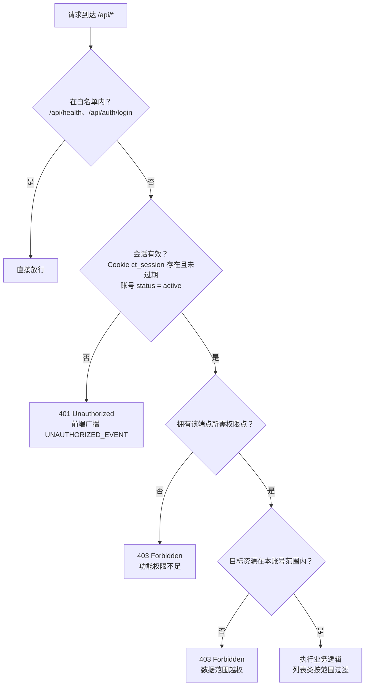
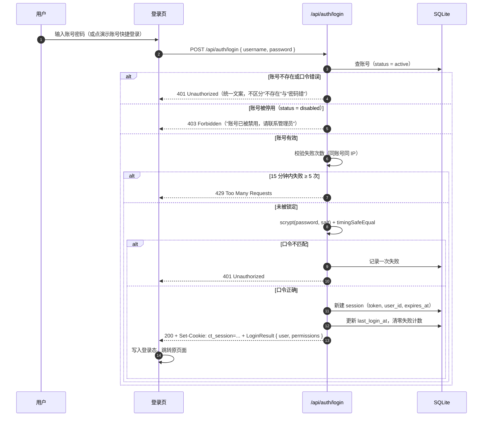
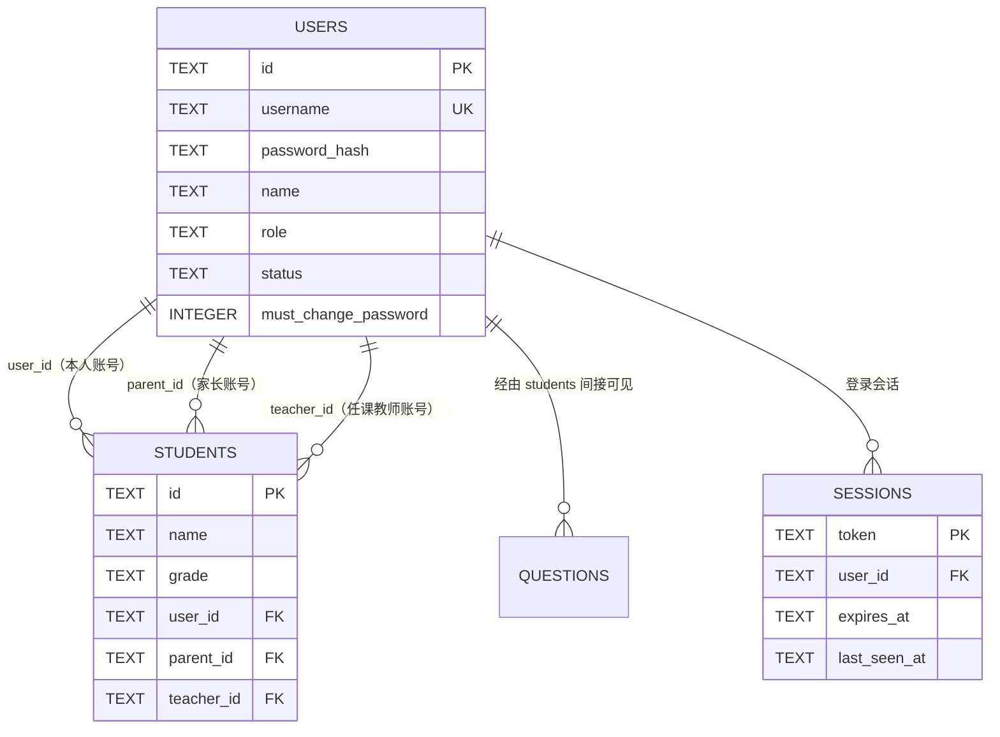
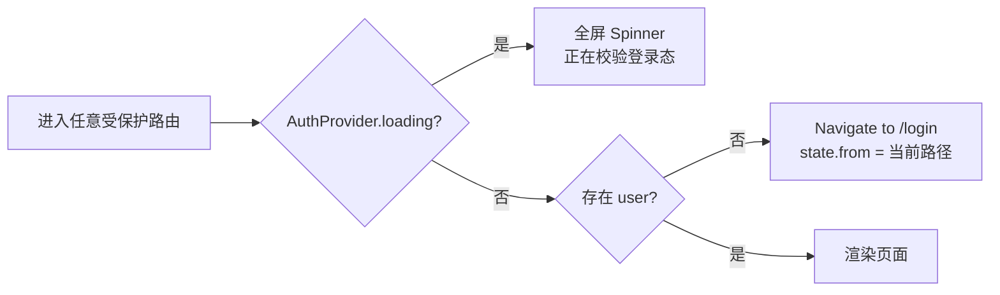

# 08 · 登录与分级权限设计

> 文档类型：安全与权限设计规格
> 版本：v1.0 ｜ 最后更新：2026-10-27
> 关联文档：[产品需求与痛点分析](./01-产品需求与痛点分析.md) ｜ [功能架构与信息架构](./02-功能架构与信息架构.md) ｜ [技术架构设计](./03-技术架构设计.md) ｜ [交互与视觉规范](./04-交互与视觉规范.md) ｜ [开发与部署指南](./05-开发与部署指南.md) ｜ [测试与验收清单](./06-测试与验收清单.md) ｜ [OCR 方案调研与选型](./07-OCR方案调研与选型.md)

> **文档约定**
> - **唯一事实来源**：后端 `server/auth.js` 中的 `PERMISSIONS` 常量；前端 `src/lib/types.ts` 的 `Role` / `Permission` / `User` / `ROLES` / `ROLE_LABEL` / `ROLE_DESC` 与之镜像。
> - 本轮功能由两位同事并行实现中，本文按**目标行为**撰写；尚未落地或由实现方决定的细节，一律标注「**待定/由后端约定**」。
> - 本文不复制大段实现代码，只给表结构、约束、端点签名与判定规则。

---

## 1. 为什么需要权限分级

### 1.1 一个系统里同时住着四种数据视角

上一轮 MVP 把"当前学生切换器"当作数据隔离手段，本质上假设**设备是可信的、只有一个操作者**。一旦系统进入真实场景，这个假设立刻崩塌：

| 使用场景 | 真实诉求 | MVP 假设的冲突 |
| --- | --- | --- |
| 一个孩子、两个家长、若干老师共用一台部署 | 家长只看自己孩子，老师只看所授班级 | 切换器能选中**任何**学生，任何人一点就看到全部数据 |
| 一所学校部署一套 | 老师导出**全班**报表，学生只做自己的错题本 | 学生与家长都能打开总览与报告页 |
| 模型配置与 API Key | 仅管理员可改 | 任何登录者都能改模型、改 OCR 配置 |
| 账号本身 | 需要停用某个离职老师的账号 | 没有账号概念 |

### 1.2 与 docs/01 痛点的对应关系

| docs/01 痛点 | 本轮能力 | 解决方式 |
| --- | --- | --- |
| **P3 家长看不懂孩子错在哪** | `parent` 角色 | 家长登录后只看自己孩子的错题与报告，多孩家庭可聚合 |
| **P4 教师无法做个性化统计** | `teacher` 角色 | 教师按"所授学生"范围聚合班级统计并导出 |
| **P7 数据孤岛** | `admin` 角色 + 账号体系 | 统一账号与关联关系，跨端共享同一份数据且互不可见 |
| **P9 隐私与成本**（数据不出本机 + AI 密钥受控） | `settings:ai` / `settings:ocr` 仅 `admin` | 学生与家长**碰不到**模型密钥与 OCR 配置 |

### 1.3 三条设计原则

1. **默认拒绝**：任何接口若未显式声明放行角色，一律拒绝；新增端点时"忘了加鉴权"应当导致 401/403 而不是放行。
2. **功能权限 × 数据权限，正交**：能不能做某件事（功能权限）与能看到哪些数据（数据权限）是两件事，必须分别判断。
3. **纵深防御**：前端隐藏入口只是体验优化，**真正的边界在服务端**。前端任何绕过手段（改 URL、直接调接口）都必须被服务端拦下。

---

## 2. 角色模型

### 2.1 四级角色职责边界

| 角色 | 枚举值 | 中文名 | 职责一句话 | 数据范围 |
| --- | --- | --- | --- | --- |
| 系统管理员 | `admin` | 系统管理员 | 账号、学生档案、系统设置（AI 模型 / OCR）唯一管理者 | 全部学生 |
| 教师 | `teacher` | 教师 | 管理所授学生的错题与班级统计，导出报表 | `students.teacher_id = 当前用户` |
| 家长 | `parent` | 家长 | 查看自己孩子的错题、统计与学情报告，可导出 | `students.parent_id = 当前用户` |
| 学生 | `student` | 学生 | 只使用自己的错题本与今日复习 | `students.user_id = 当前用户` |

> 角色元数据（中文名、描述、徽章配色）在前端 `src/lib/types.ts` 的 `ROLE_LABEL` / `ROLE_DESC` 与 `src/features/auth/roleMeta.ts` 的 `ROLE_TONE` / `ROLE_COLOR` 中定义：`admin` 紫、`teacher` 蓝、`parent` 绿、`student` 橙。

### 2.2 每级角色"能看什么 / 不能看什么 / 典型场景"

#### admin —— 系统管理员

| 维度 | 内容 |
| --- | --- |
| **能看** | 全部学生、全部错题、全部统计与报告、全部账号；AI 模型配置与 OCR 配置（密钥读取时掩码） |
| **能做** | 账号增删改、停用、重置密码、关联学生；学生档案增删改；修改 AI/OCR 设置；导出任意范围报表 |
| **不能做** | —（唯一拥有 `settings:ai` / `settings:ocr` / `users:manage` 的角色） |
| **典型场景** | 学校/机构的系统负责人。首次部署后用 `admin` 账号建教师、家长、学生账号，配置模型与 OCR，绑定班级关系 |

#### teacher —— 教师

| 维度 | 内容 |
| --- | --- |
| **能看** | 所授学生的错题、班级维度统计（学科分布、错因构成、知识点掌握）、所授学生的学情诊断报告 |
| **能做** | 为所授学生录入/订正错题、编辑学生档案（`students:update`）、导出报表 |
| **不能做** | 增删学生档案（`students:create` / `students:delete` 仅 admin）、查看**非所授**学生的数据、查看或修改 AI/OCR 设置、管理账号 |
| **典型场景** | 班主任统计全班错因构成、导出 xlsx 作为分层作业素材；或批改时帮学生补录一道错题 |

#### parent —— 家长

| 维度 | 内容 |
| --- | --- |
| **能看** | 自己孩子（可多个）的错题、统计与学情诊断报告，含"家长沟通要点" |
| **能做** | 为孩子录入/订正错题、导出报表（给孩子或学校留底） |
| **不能做** | 查看其他家庭的孩子；**删除**学生档案（`students:delete` 仅 admin）；改 AI/OCR 设置；管理账号；查看班级级聚合（无此概念） |
| **典型场景** | 晚 8 点打开报告，看"计算失误占 41%——不是不会，是算错"，导出本周错题清单给孩子重做 |

#### student —— 学生

| 维度 | 内容 |
| --- | --- |
| **能看** | 自己的错题本、自己的统计总览、自己的今日复习队列 |
| **能做** | 拍照录入、订正、标记复习 |
| **不能做** | **查看学情诊断报告**（`report:read` 不含 student）、**导出报表**（`export:run` 不含 student）、查看他人数据、删除错题、修改系统设置、管理账号 |
| **典型场景** | 放学路上拍三道错题，晚上做"今日复习"，界面里看不到任何"评估""报告""设置"字样 |

> **为什么学生不能看报告**：`InsightReport` 里的"高风险学科""薄弱项""家长沟通要点"面向成年人设计；过早暴露评价性结论对小学阶段的学习动机有害（见 docs/01 §1.1 原则 P3）。学生的反馈闭环由"错题本 + 今日复习 + 掌握度"承担。

---

## 3. 权限矩阵

### 3.1 16 个权限点 × 4 角色

`PERMISSIONS` 定义在后端 `server/auth.js`，前端 `Permission` 类型与之镜像（`src/lib/types.ts`）。

| 权限点 | 含义 | admin | teacher | parent | student |
| --- | --- | :-: | :-: | :-: | :-: |
| `students:read` | 查看学生档案列表/详情 | ✅ | ✅ | ✅ | ✅ |
| `students:create` | 新建学生档案 | ✅ | ❌ | ❌ | ❌ |
| `students:update` | 修改学生档案 | ✅ | ✅ | ❌ | ❌ |
| `students:delete` | 删除学生档案 | ✅ | ❌ | ❌ | ❌ |
| `questions:read` | 查看错题 | ✅ | ✅ | ✅ | ✅ |
| `questions:create` | 录入错题 | ✅ | ✅ | ✅ | ✅ |
| `questions:update` | 修改错题 / 标记订正 | ✅ | ✅ | ✅ | ✅ |
| `questions:delete` | 删除错题 | ✅ | ✅ | ✅ | ❌ |
| `stats:read` | 查看统计总览 | ✅ | ✅ | ✅ | ✅ |
| `report:read` | 查看学情诊断报告 | ✅ | ✅ | ✅ | ❌ |
| `export:run` | 导出 xlsx / csv | ✅ | ✅ | ✅ | ❌ |
| `review:run` | 今日复习 / 订正闭环 | ✅ | ✅ | ✅ | ✅ |
| `settings:ai` | 修改 AI 模型设置 | ✅ | ❌ | ❌ | ❌ |
| `settings:ocr` | 修改 OCR 配置 | ✅ | ❌ | ❌ | ❌ |
| `system:update` | 系统更新（检查 / 下载 / 覆盖 / 回滚 / 发布新版本） | ✅ | ❌ | ❌ | ❌ |
| `users:manage` | 账号管理 | ✅ | ❌ | ❌ | ❌ |

**读法**：✅ = 放行；❌ = 拒绝（返回 403）。

### 3.2 权限点的设计取舍

| 决策 | 说明 |
| --- | --- |
| `students:read` 对**所有**角色开放 | 家长与学生需要看到自己的档案信息（年级、头像）；教师需要看到所授学生列表。真正限制的是**范围**而非"能不能读"，范围由 §4 的数据权限决定 |
| `students:update` 给 teacher | 教师需要修正学生年级、备注等档案信息；但**新建/删除档案**属于校务管理动作，只给 admin |
| `questions:delete` 给 parent 但不给 student | 家长需要清理重复上传的照片与错题；学生只允许订正，不允许删除（避免"做错就删掉"） |
| `report:read` 不给 student | 见 §2.2 说明 |
| `export:run` 不给 student | 导出是给成年人做二次加工（打印、讲义、沟通）的动作 |
| `settings:*` 仅 admin | AI 密钥与 OCR 配置是**成本与合规的开关**，必须与学生/家长/教师隔离 |
| `users:manage` 仅 admin | 账号是权限体系的根，普通角色不能自助提权 |
| `system:update` 与 `settings:ai` 分离 | 「改模型配置」与「升级系统 / 发布新版本」是**两种风险量级**的动作：前者只影响 AI 行为，后者会替换服务器上的代码文件、并能向外上传内容。把二者拆成两个权限点，便于将来把「可改模型、不可升级」的角色区分出来 |

### 3.3 权限矩阵预览界面（`/users` 账号管理页）

面向管理员提供一张**只读**的矩阵预览表，帮助其理解"我新建的账号会拿到什么"：

| 界面要素 | 规范 |
| --- | --- |
| 矩阵表 | 行 = 16 个权限点（中文名 + 权限标识），列 = 4 个角色；单元格用 ✓ / — 标记，✓ 用角色徽章色 |
| 表头 | 列头显示角色中文名 + 徽章（admin 紫 / teacher 蓝 / parent 绿 / student 橙） |
| 权限点中文名 | 与 `ROLE_LABEL` 同一套文案体系，如"查看学生档案""导出报表""修改 AI 模型设置" |
| 交互 | **只读预览，不可编辑**；矩阵来自 `GET /api/auth/permissions`（后端 `PERMISSIONS` 的镜像），保证与运行时判定完全一致 |
| 权限变更路径 | 矩阵是**角色级固定**的；要改变某个账号的能力，方式是**改该账号的角色**，而不是单独给账号加权限点 |

> **为什么不做"自定义权限"**：MVP 阶段角色固定为 4 级、权限矩阵固定为 15 点，带来的好处是**判定逻辑可穷举、可测试、可解释**。一旦允许任意组合，就必须回答"这个组合下导出范围怎么算""这个组合下 AI 密钥谁看得到"等组合爆炸问题。演进路线见 §11。

---

## 4. 数据范围隔离

### 4.1 两个正交维度

| | 判定内容 | 判定依据 | 失败表现 |
| --- | --- | --- | --- |
| **功能权限**（能不能做） | 该角色是否拥有这个权限点 | `PERMISSIONS[role]` 是否包含该权限点 | **403 Forbidden** |
| **数据权限**（能看到谁） | 目标学生是否落在该账号的数据范围内 | 账号与学生的关联关系 | 越权操作 **403**；列表查询则**过滤后返回**（200 + 子集） |

**正交示例**：

| 场景 | 功能权限 | 数据权限 | 结果 |
| --- | --- | --- | --- |
| 家长访问自己孩子的错题 | `questions:read` ✅ | 在范围内 ✅ | 200 返回数据 |
| 家长访问别人孩子的错题 | `questions:read` ✅ | **不在范围内** ❌ | **403**（不返回 404，避免暴露"存在性"） |
| 学生访问学情报告 | `report:read` ❌ | 范围无关 | **403**（前端根本不给入口） |
| 教师访问非所授学生的错题 | `questions:read` ✅ | **不在范围内** ❌ | **403** |
| 家长列出学生列表 | `students:read` ✅ | 按范围过滤 | 200，仅返回自己的孩子 |

### 4.2 范围判定流程



### 4.3 范围映射规则

| 角色 | 判定条件 | 关联字段（`students` 表） |
| --- | --- | --- |
| `admin` | 恒真 | — |
| `teacher` | 该学生被指派给当前账号 | `students.teacher_id = 当前用户 id` |
| `parent` | 该学生是当前账号的孩子 | `students.parent_id = 当前用户 id` |
| `student` | 该学生档案就是当前账号本人 | `students.user_id = 当前用户 id` |

### 4.4 强制按范围过滤的端点

以下端点**必须**在服务端做范围判定，缺一不可：

| 端点族 | 过滤方式 | 越权时 |
| --- | --- | --- |
| `GET /api/students` | 只返回范围内学生 | 200 + 子集 |
| `GET /api/questions` | 按范围内 `student_id` 集合过滤；**显式传范围外 `studentId` → 403** | 200 + 子集 |
| `GET /api/questions/:id` | 校验该题所属学生是否在范围内 | 403 |
| `PATCH /api/questions/:id` | 同上 | 403 |
| `DELETE /api/questions/:id` | 同上 | 403 |
| `GET /api/stats/overview` | 统计仅覆盖范围内学生；显式传范围外 `studentId` → 403 | 200 + 子集统计 |
| `GET /api/stats/report` | 同上 | 200（无数据则空报告）/ 403（显式指定越权 `studentId`） |
| `GET /api/stats/export` | 导出内容仅含范围内学生 | 200 + 子集 |
| `POST /api/analyze/photo` | 归入范围校验；生成结果的归属学生必须在范围内 | 403 |
| `POST /api/ai/chat` | 对话上下文仅使用范围内学生的错题与统计 | 200（范围内）/ 403（显式指定越权 `studentId`） |
| `POST /api/upload/photo` | 上传本身不涉他人数据，但需具备 `questions:create` 权限点 | 401 / 403 |

> **实现要点**：`GET /api/stats/overview` 的"当前学生"语义在多账号下必须改为"范围内学生集合"。当范围内只有一个学生时前端仍可显示单学生视图；范围为空时返回空统计（不是 403）。
> **过滤 vs 拒绝的取舍**：列表类端点返回"过滤后的子集"而不是 403，原因是 403 会让教师无法使用列表页；而**单体资源的读写**必须 403，因为那是明确的越权动作。

### 4.5 `studentId` 参数的处理

客户端在多处显式传 `studentId`（统计、报告、导出、对话）。服务端必须：

1. **忽略**范围外的 `studentId` 或**直接 403**，二选一但要全局一致；
2. `admin` 可传任意 `studentId`；
3. 非 admin 传范围外 `studentId` 时返回 **403**（推荐），而不是"悄悄返回空结果"——空结果会让用户以为"这个学生没有数据"，掩盖越权事实。

> **统一口径（已实现）**：凡是**显式传入范围外的 `studentId`**，一律返回 **403**（`/api/questions`、`/api/stats/overview`、`/api/stats/report`、`/api/stats/export`、`/api/ai/chat` 均如此）；**未传 `studentId`** 时按范围自动收窄——范围内只有一个学生时自动命中该学生，多个学生时按端点既有语义聚合，全部端点的返回内容都只包含范围内学生的数据。

---

## 5. 认证与会话

### 5.1 口令存储：scrypt

| 项 | 方案 | 说明 |
| --- | --- | --- |
| 算法 | Node 内置 `crypto.scrypt(password, salt, 64)` | 无第三方依赖；scrypt 是**内存硬（memory-hard）**函数 |
| 盐 | 每账号随机 16 字节，十六进制存库 | 相同口令不同账号哈希不同，杜绝彩虹表批量比对 |
| 存储格式 | `scrypt$<saltHex>$<hashHex>` | 自描述格式，未来可平滑换算法（如 `argon2id$...`） |
| 比对 | `crypto.timingSafeEqual` | 恒定时间比较，避免计时侧信道泄露前缀信息 |

**为什么是 scrypt 而不是 bcrypt/argon2**：

| 理由 | 说明 |
| --- | --- |
| 零依赖 | Node ≥ 22 内置 `crypto.scrypt`，不需要 `bcrypt`（原生编译）或 `argon2`（原生编译）。本项目的部署主张是"拷贝即跑、零运维"，原生模块会破坏这一点（参见 docs/03 ADR-2/ADR-7） |
| 抗 GPU 爆破 | scrypt 需要较大的内存与计算成本，GPU/ASIC 并行收益远低于纯哈希方案 |
| 可升级 | 存储格式带算法前缀，日后可加 `argon2id$` 前缀并在新口令上重哈希，**旧口令不受影响** |

**代价与结论**：scrypt 的参数（N/r/p）需要在目标硬件上标定——**目标机器上单次哈希约 100–300 ms** 是合理区间，过慢会拖垮登录接口，过快则降低爆破成本。**具体参数待定/由后端约定**，但需在 §10 运维中记录基准值。

### 5.2 会话机制

| 项 | 方案 | 说明 |
| --- | --- | --- |
| token | 32 字节密码学随机数，Base64/十六进制编码 | 不可预测；不可从账号信息推导 |
| 存储 | `sessions` 表：`token`(PK) `user_id` `created_at` `expires_at` `user_agent` `ip` | 服务端可随时吊销（登出、停用账号、重置口令）；建 `user_id` 与 `expires_at` 索引 |
| Cookie 名 | `ct_session` | 与站点其他 Cookie 不冲突 |
| Cookie 属性 | `HttpOnly; SameSite=Lax; Path=/; Max-Age=2592000` | 见下表 |
| 有效期 | 30 天，**滑动续期**（每次有效请求刷新过期时间） | 活跃用户不掉线，长期不活跃自动失效 |
| 注销 | 删除 `sessions` 行 + 清 Cookie | 服务端吊销，不只是前端清状态 |
| 前端传递 | `fetch(..., { credentials: 'include' })` | 见 `src/lib/api.ts` 的 `request()` |

**Cookie 属性逐项依据**：

| 属性 | 取值 | 依据 |
| --- | --- | --- |
| `HttpOnly` | 开启 | JavaScript 读不到会话 token，**XSS 无法直接窃取会话**（配合 §9.4 的输出转义） |
| `SameSite=Lax` | Lax | 阻断跨站 POST 的 Cookie 携带（CSRF 防御，见 §9.6）；同时保留顶级导航的 GET（从外链跳回仍可用） |
| `Path=/` | 全站 | 会话对全站 API 有效 |
| `Max-Age=2592000` | 30 天 | 与滑动续期窗口一致；避免"浏览器关闭即掉线"的家用设备挫败感 |
| `Secure` | **当前实现未开启，建议生产开启** | 仅在 HTTPS 下传输。**本地开发（http://localhost）不能开启**，否则 Cookie 不生效 → **具体开关策略待定/由后端约定**（建议：生产环境按 `NODE_ENV` 或显式环境变量自动启用） |

### 5.3 登录流程



**失败计数与锁定**：

| 规则 | 值 | 说明 |
| --- | --- | --- |
| 计数维度 | **同账号 + 同 IP** | 既防针对单账号的爆破，也防用一个账号喷多个账号（分布式） |
| 窗口 | 15 分钟 | 滑动窗口 |
| 阈值 | 5 次失败 → 锁定 | 之后同账号同 IP 的登录请求直接 **429** |
| 解除 | 登录成功即清零 / 窗口自然过期 | 避免"一次误触锁死半小时" |
| 存储 | **进程内内存 Map**（键为 `username\|ip`，值为 `{ count, firstAt }`，窗口过期自动清理） | 单机够用；**重启即清零、多机不共享**（见 §11 R6） |

**登录响应体**（对齐 `src/lib/types.ts` 的 `LoginResult`）：

```jsonc
{
  "user": {
    "id": "usr_xxx",
    "username": "teacher",
    "name": "张老师",
    "role": "teacher",
    "avatarColor": "#3b63f6",
    "status": "active",
    "lastLoginAt": "2026-10-27T09:12:00.000Z",
    "createdAt": "2026-10-20T02:00:00.000Z",
    "linkedStudentIds": ["stu_001", "stu_002"],
    "mustChangePassword": false
  },
  "permissions": ["students:read", "questions:read", "questions:create", "questions:update", "questions:delete", "stats:read", "report:read", "export:run", "review:run"]
}
```

### 5.4 首个管理员与演示账号

| 项 | 值 | 说明 |
| --- | --- | --- |
| 首个管理员账号 | 首次启动自动创建 | 用户名 `ADMIN_USERNAME`（默认 `admin`），口令 `ADMIN_PASSWORD`（默认 `admin123`） |
| 强制改密 | `must_change_password = 1` | 首次登录后提示修改；**不得长期保留默认口令** |
| 演示账号 | `teacher/teacher123`、`parent/parent123`、`student/student123` | 仅用于演示与验收，**生产部署必须删除或改密** |

> 演示账号的存在是"开箱 5 分钟看到效果"的代价，也是安全负债：生产上线检查项必须包含"删除演示账号 / 改密"。见 [docs/05](./05-开发与部署指南.md) 的部署检查清单。

---

## 6. 账号与学生关联

### 6.1 三个外键的语义

`students` 表新增三个可空外键列（**目标结构**）：

| 列 | 类型 | 语义 | 由谁维护 |
| --- | --- | --- | --- |
| `user_id` | TEXT NULL | 该学生档案**本人**的登录账号（`role = student`） | admin 在账号管理中绑定；也可由家长/教师建档时同步创建 |
| `parent_id` | TEXT NULL | 该学生的**家长账号**（可多个孩子 → 多个学生的 `parent_id` 指向同一账号） | admin 或教师在账号管理中关联 |
| `teacher_id` | TEXT NULL | 该学生的**任课教师账号**（一个老师多个学生） | admin 或教师在账号管理中关联 |



### 6.2 一对多关系

| 关系 | 基数 | 实现 |
| --- | --- | --- |
| 家长 → 孩子 | 1 : N | 多个学生的 `parent_id` 指向同一 `users.id` |
| 教师 → 学生 | 1 : N | 多个学生的 `teacher_id` 指向同一 `users.id` |
| 学生账号 → 本人档案 | 1 : 0..1 | 学生账号的 `user_id` 指向自己的档案 |
| 学生 → 家长 | N : 1 | 单档案一个 `parent_id`；**多个家长（父母双方）需扩展为关联表，属 P1**（见 §11） |

> **当前限制**：`parent_id` / `teacher_id` 是单列，**一个学生只能绑定一个家长账号和一个教师账号**。离异家庭、双教师（班主任+任课老师）等场景需要独立关联表 `user_students(user_id, student_id, relation)` —— 已列入演进路线。

### 6.3 关联操作

| 操作 | 端点 | 效果 |
| --- | --- | --- |
| 建立关联 | `POST /api/users/:id/students/:studentId` | 写入对应外键（或关联表）；返回更新后的账号 |
| 解除关联 | `DELETE /api/users/:id/students/:studentId` | 清空对应外键；返回更新后的账号 |

**改关联时历史数据归属如何保持**：

| 规则 | 说明 |
| --- | --- |
| **错题数据不迁移** | 错题归属由 `questions.student_id` 决定，与账号无关。改关联只改变"谁能看到"，**不改变"数据属于谁"** |
| 解除关联 = 立即失去可见性 | 教师被解绑后，其历史导出的报表不受影响，但系统内立即无法再访问该学生 |
| 换家长 = 可见性转移 | 新家长立刻能看到孩子全部历史错题与报告；旧家长立即失去访问 |
| 停用账号 = 保留数据 | 账号 `status = disabled` 后不可登录，但其关联学生的历史数据完整保留 |
| 删除账号 | 需先解除关联；**删除账号不级联删除学生档案与错题**（避免误删教学数据）→ **具体级联策略待定/由后端约定** |

---

## 7. 接口鉴权矩阵

### 7.1 401 与 403 的区别

| 状态码 | 含义 | 触发条件 | 前端行为 |
| --- | --- | --- | --- |
| **401 Unauthorized** | **没证明你是谁** | 无 Cookie、会话过期、会话被吊销、账号被停用 | `src/lib/api.ts` 广播 `UNAUTHORIZED_EVENT` → `AuthProvider` 清空登录态 → 跳转 `/login` |
| **403 Forbidden** | **知道你是谁，但你不能做这件事** | 缺少权限点，或目标资源不在数据范围内 | 停留在当前页，Toast 提示"没有权限"；**不跳转登录页** |

> 401 与 403 的区分是前端体验的关键：403 跳登录会让用户以为"掉线了"，反复登录却依然失败。

### 7.2 端点 × 角色

| 端点 | 权限点 | admin | teacher | parent | student | 备注 |
| --- | --- | :-: | :-: | :-: | :-: | --- |
| `GET /api/health` | — | ✅ | ✅ | ✅ | ✅ | **唯一免登录**（健康检查） |
| `POST /api/auth/login` | — | ✅ | ✅ | ✅ | ✅ | **免登录**；`200` + `Set-Cookie`；空参数 400 / 口令错 401 / 账号停用 403 / 锁定 429 |
| `POST /api/auth/logout` | 已登录 | ✅ | ✅ | ✅ | ✅ | `204`；删会话行 + 清 Cookie |
| `GET /api/auth/me` | 已登录 | ✅ | ✅ | ✅ | ✅ | 返回 `{ user, permissions }`；未登录 401 |
| `GET /api/auth/permissions` | 已登录 | ✅ | ✅ | ✅ | ✅ | 权限矩阵（只读预览数据源） |
| `POST /api/auth/password` | 已登录 | ✅ | ✅ | ✅ | ✅ | 改**自己**的口令（校验旧口令）；改密后吊销本账号其它会话 |
| `GET /api/users` | `users:manage` | ✅ | ❌ 403 | ❌ 403 | ❌ 403 | `200 User[]` |
| `POST /api/users` | `users:manage` | ✅ | ❌ 403 | ❌ 403 | ❌ 403 | `200 User`；用户名重复 → `409 Conflict` |
| `PATCH /api/users/:id` | `users:manage` | ✅ | ❌ 403 | ❌ 403 | ❌ 403 | `200 User`；编辑账号/角色/停用 |
| `DELETE /api/users/:id` | `users:manage` | ✅ | ❌ 403 | ❌ 403 | ❌ 403 | `204`；删自己或删最后一个管理员 → `400` |
| `POST /api/users/:id/password` | `users:manage` | ✅ | ❌ 403 | ❌ 403 | ❌ 403 | `200 { ok: true }`；重置后吊销该账号其它会话 |
| `POST /api/users/:id/students/:studentId` | `users:manage` | ✅ | ❌ 403 | ❌ 403 | ❌ 403 | `200 User`；**管理员角色不支持关联学生** → `400` |
| `DELETE /api/users/:id/students/:studentId` | `users:manage` | ✅ | ❌ 403 | ❌ 403 | ❌ 403 | `200 User`；只清空对应外键 |
| `GET /api/students` | `students:read` | ✅ | ✅ | ✅ | ✅ | **按范围过滤**返回 |
| `POST /api/students` | `students:create` | ✅ | ❌ 403 | ❌ 403 | ❌ 403 | — |
| `PATCH /api/students/:id` | `students:update` | ✅ | ✅ | ❌ 403 | ❌ 403 | 越权学生 403 |
| `DELETE /api/students/:id` | `students:delete` | ✅ | ❌ 403 | ❌ 403 | ❌ 403 | — |
| `GET /api/questions` | `questions:read` | ✅ | ✅ | ✅ | ✅ | **按范围过滤** |
| `GET /api/questions/:id` | `questions:read` | ✅ | ✅ | ✅ | ✅ | 越权 403 |
| `POST /api/questions` | `questions:create` | ✅ | ✅ | ✅ | ✅ | `studentId` 须在范围内，否则 403 |
| `PATCH /api/questions/:id` | `questions:update` | ✅ | ✅ | ✅ | ✅ | 越权 403 |
| `DELETE /api/questions/:id` | `questions:delete` | ✅ | ✅ | ✅ | ❌ 403 | 越权 403 |
| `POST /api/questions/:id/corrected` | `review:run` | ✅ | ✅ | ✅ | ✅ | 越权 403 |
| `POST /api/questions/:id/analyze` | `questions:update` | ✅ | ✅ | ✅ | ✅ | 越权 403 |
| `POST /api/upload/photo` | `questions:create` | ✅ | ✅ | ✅ | ✅ | 需该权限点 |
| `GET /api/upload/:filename` | 已登录 | ✅ | ✅ | ✅ | ✅ | **按归属校验**：上传者本人 / 归属学生在范围内 / admin 才放行，否则 403 |
| `POST /api/analyze/photo` | `questions:create` | ✅ | ✅ | ✅ | ✅ | 归属学生须在范围内，否则 403 |
| `GET /api/stats/overview` | `stats:read` | ✅ | ✅ | ✅ | ✅ | **按范围聚合** |
| `GET /api/stats/report` | `report:read` | ✅ | ✅ | ✅ | ❌ 403 | 越权 `studentId` → 403 |
| `GET /api/stats/export` | `export:run` | ✅ | ✅ | ✅ | ❌ 403 | 导出内容按范围裁剪 |
| `GET /api/knowledge/points` | `questions:read` | ✅ | ✅ | ✅ | ✅ | 建议按范围过滤（**待定/由后端约定**） |
| `POST /api/ai/chat` | `stats:read` | ✅ | ✅ | ✅ | ✅ | 上下文按范围裁剪；越权 `studentId` → 403 |
| `GET /api/settings/providers` | 已登录 | ✅ | ✅ | ✅ | ✅ | 供应商预设不含密钥，可放开 |
| `GET /api/settings/ai` | `settings:ai` | ✅ | ❌ 403 | ❌ 403 | ❌ 403 | 密钥掩码返回 |
| `PUT /api/settings/ai` | `settings:ai` | ✅ | ❌ 403 | ❌ 403 | ❌ 403 | 掩码值视为"不修改" |
| `DELETE /api/settings/ai` | `settings:ai` | ✅ | ❌ 403 | ❌ 403 | ❌ 403 | 恢复默认 |
| `POST /api/settings/ai/test` | `settings:ai` | ✅ | ❌ 403 | ❌ 403 | ❌ 403 | 连通性测试 |
| `GET /api/settings/ocr` | `settings:ocr` | ✅ | ❌ 403 | ❌ 403 | ❌ 403 | OCR 配置（前端自检走 `{ocrBaseUrl}/health` 直连，不经后端） |
| `PUT /api/settings/ocr` | `settings:ocr` | ✅ | ❌ 403 | ❌ 403 | ❌ 403 | 保存 OCR 配置 |
| `GET /api/system/config` | 已登录 | ✅ | ✅ | ✅ | ✅ | 非敏感配置（仓库地址、代理地址、`hasToken` 布尔），任何登录用户可读；**令牌永不明文回显** |
| `PUT /api/system/config` | `system:update` | ✅ | ❌ 403 | ❌ 403 | ❌ 403 | 保存更新源配置（`repo` / `autoRestart` / `proxy` / `token`）；`repo` 非 `owner/repo` 或 `proxy` 非法 → 400 |
| `GET /api/system/update/info` | `system:update` | ✅ | ❌ 403 | ❌ 403 | ❌ 403 | 最新 Release 概况；未配置仓库 → `configured:false` + 提示，**不报错** |
| `POST /api/system/update/apply` | `system:update` | ✅ | ❌ 403 | ❌ 403 | ❌ 403 | 触发更新，**立即返回**，后台异步执行 |
| `GET /api/system/update/status` | `system:update` | ✅ | ❌ 403 | ❌ 403 | ❌ 403 | 更新任务状态与日志 |
| `POST /api/system/update/rollback` | `system:update` | ✅ | ❌ 403 | ❌ 403 | ❌ 403 | 回滚到上次更新前的备份，**立即返回**，后台异步执行 |
| `POST /api/system/update/publish` | `system:update` | ✅ | ❌ 403 | ❌ 403 | ❌ 403 | **发布新版本**：打包本机源码 → 创建 GitHub Release（tag = `v版本号`）→ 上传附件 |

> **关于 OCR 配置**：前端对本地 OCR 服务的自检采用**直连**方式 —— 浏览器直接请求 `GET {ocrBaseUrl}/health`（`src/features/settings/OcrHealthCheck.tsx`），**不经过本系统后端**，因此后端**不需要**提供 `GET /api/settings/ocr` 端点。表中该行仅表示"OCR 相关的配置项写入能力归属于 admin"，具体读写路径随本地 OCR 部署方式而定。

### 7.3 统一错误响应

沿用 docs/03 的 `{ "error": "<错误码>", "message": "<可读提示>" }` 结构，新增两个错误码：

| HTTP | `error` | 含义 | 典型 `message` |
| --- | --- | --- | --- |
| `401` | `Unauthorized` | 未登录 / 会话失效 / 账号停用 | "登录状态已失效，请重新登录" |
| `403` | `Forbidden` | 权限不足或数据越权；**或登录时账号已被禁用** | "当前角色无权访问该资源" / "账号已被禁用，请联系管理员" |
| `409` | `Conflict` | 资源冲突 | 新建账号时用户名已存在 → "该用户名已被占用" |
| `429` | `TooManyRequests` | 登录失败次数超限 | "登录尝试过于频繁，请 15 分钟后再试" |

---

## 8. 前端体验

### 8.1 登录页 `/login`

| 项 | 规范 |
| --- | --- |
| 布局 | **PC：左右分栏** —— 左侧品牌区（产品名 + 一句话价值 + 卖点列表），右侧登录表单；**手机：单列** —— 品牌区收起，表单占满，顶部只留 Logo |
| 表单字段 | 用户名、口令；口令框可切换明文（`type` 切换），默认隐藏 |
| 提交 | 按钮「登录」；提交中显示 loading 且禁用重复提交；`Enter` 可直接提交 |
| 错误提示 | 401 → 表单下方红色提示「账号或口令不正确」；429 → 提示剩余等待时间；**不区分"账号不存在"与"口令错误"**（防账号枚举） |
| 演示账号 | 4 个快捷登录按钮：`admin/admin123`、`teacher/teacher123`、`parent/parent123`、`student/student123`；仅在开发/演示环境展示（**生产是否隐藏待定/由前端约定**） |
| 首次改密 | 返回的 `user.mustChangePassword = true` 时，引导修改口令后再进入系统 |
| 登录后去向 | 跳回 `ProtectedRoute` 记录的 `state.from`；无来源时统一回到 `/`（**当前实现不区分角色落地页**） |

### 8.2 路由守卫



- 实现位置：`src/features/auth/ProtectedRoute.tsx`（已落地）。
- 登录态校验：应用启动时调用 `api.me()`；失败**静默清空**（不弹错误）。
- 任意接口返回 401 → `src/lib/api.ts` 广播 `UNAUTHORIZED_EVENT` → `AuthProvider` 清空登录态 → 页面跳登录。
- 登录页自身**不得**被守卫包裹（否则未登录无法进入登录页）。

### 8.3 权限点门控 `PermissionGate`

`src/features/auth/PermissionGate.tsx`（已落地）：

| 属性 | 行为 |
| --- | --- |
| `perm` | 单个权限点或权限点数组（**任一满足**即放行） |
| 有权限 | 渲染 `children` |
| 无权限且传了 `fallback` | 渲染 `fallback` |
| 无权限且未传 `fallback` | 渲染默认说明卡：「当前角色无权查看此内容」+「请联系系统管理员在『账号管理』中调整角色权限」 |

**用法约定**：用于**整块内容**（报告区、导出按钮、设置页）；**导航项**的显隐在 `AppShell` 的 `NAV` 中按权限过滤。

### 8.4 顶栏用户菜单

| 元素 | 规范 |
| --- | --- |
| 入口 | 顶栏右侧头像（点击展开下拉） |
| 菜单内容 | 头像 + 姓名 + **角色徽章**（角色中文名 + 角色色）；菜单项为「我的账号」「修改密码」「退出登录」 |
| 角色徽章 | 复用 `ROLE_LABEL` 与 `roleMeta.ts` 的 `ROLE_TONE`：admin 紫 / teacher 蓝 / parent 绿 / student 橙 |
| 退出登录 | 调用 `api.logout()`；**无论后端成功与否都清空本地登录态**并跳转 `/login` |
| 修改密码 | `POST /api/auth/password`：填「当前密码 / 新密码 / 确认新密码」，新密码 ≥6 位；成功后吊销该账号其它会话并把 `must_change_password` 归零。**任何登录用户都可改自己的口令**；管理员另可在「账号管理」中为他人重置口令 |
| 移动端 | 用户菜单挂在顶栏头像上；受权限隐藏的导航项（账号管理 / 模型设置）不进入底部导航 |

### 8.5 无权限时的降级表现

| 情况 | 表现 |
| --- | --- |
| 导航项无权限 | **直接不渲染**该导航项（不置灰、不提示，避免暴露功能存在性） |
| 页面内区块无权限 | `PermissionGate` 的说明卡，文案指向"联系系统管理员" |
| 直接访问无权限路由 | 由服务端返回 403 → 前端 Toast 提示 + 停留在当前页 |
| 数据为空（范围内确实没有学生） | 显示空状态引导，**不显示 403 文案**（0 条数据 ≠ 无权限） |
| 会话过期 | 立即跳登录页，登录后回到原页面（`state.from`） |

---

## 9. 安全设计

### 9.1 口令策略

| 规则 | 值 | 依据 |
| --- | --- | --- |
| 最小长度 | 8 位（管理员首次口令建议 ≥ 12 位） | 短口令是账号被撞库的首要原因 |
| 复杂度 | 至少包含字母与数字 | 演示账号 `teacher123` 已满足 |
| 强度提示 | 创建/改密时给出强度条提示 | 教育场景以引导为主，不做硬性拦截（避免卡住家长） |
| 禁止复用默认口令 | 首次登录强制修改（`must_change_password`） | 默认口令 `admin123` 公开可见，必须失效 |
| 禁止明文存储 | 仅存 `scrypt$salt$hash` | 库文件泄露不等于口令泄露 |
| 禁止明文回显 | 接口返回体不含 `password` / `password_hash` | 避免前端日志与 DevTools 泄露 |
| 找回方式 | 无自助找回（无邮件服务）→ 管理员重置 | 见 §10.2 |
| 自助改密 | **已提供**：`POST /api/auth/password`（校验旧口令 + 新口令 ≥6 位且不等于旧口令 + 吊销本账号其它会话 + `must_change_password` 归零） | 任何登录用户都能改自己的口令；管理员重置他人口令后该账号全部会话立即失效 |

### 9.2 暴力破解防护

| 措施 | 参数 | 依据 |
| --- | --- | --- |
| 登录失败锁定 | 同账号同 IP / 15 分钟 / 5 次 → 429 | 成本极低的自动化防御，阻断单账号爆破与账号喷洒 |
| scrypt 内存硬 | 参数标定使单次校验 ~100–300ms | 让每次尝试本身就很贵 |
| 统一失败文案 | 不区分账号不存在 / 口令错 / 账号停用 | 防账号枚举 |
| 停用账号立即失效 | `status = disabled` 时登录返回 `403`，其已有会话在管理端停用时被吊销 | 离职教师不应继续访问 |
| 口令重置后吊销会话 | 重置口令时删除该账号全部 `sessions` | 改密通常意味着"怀疑泄露" |

### 9.3 越权防护

| 措施 | 说明 |
| --- | --- |
| 服务端强制鉴权 | 所有端点在 `server/auth.js` 的中间件中统一校验，**不依赖前端隐藏入口** |
| 范围过滤下沉到 SQL | 范围条件与业务条件写在同一个 `WHERE` 中，避免"先查后过滤"造成的数据泄漏或性能陷阱 |
| 单体资源 403 | 详情/修改/删除必须校验归属 |
| 列表返回子集 | 列表/统计/导出按范围裁剪 |
| 导出同样受控 | 导出是最容易造成批量泄漏的通道，必须与界面使用同一套范围判定 |

### 9.4 密钥保护

| 措施 | 说明 |
| --- | --- |
| 掩码返回 | `GET /api/settings/ai` 返回的 `apiKey` 为掩码值；`PUT` 收到掩码视为"不修改"（沿用 `server/routes/settings.js` 的既有约定） |
| 仅 admin 可读写 | `settings:ai` / `settings:ocr` 只授予 admin |
| 服务端存储 | 密钥落服务端配置，**不随响应体下发完整值**，不写日志 |
| 前端不可见 | 前端 `src/lib/api.ts` 只调用设置接口，不持有密钥常量 |

### 9.5 会话撤销

| 触发 | 行为 |
| --- | --- |
| 用户点退出 | 删除该 token 对应的 `sessions` 行 + 清 Cookie |
| 管理员停用账号 | 该账号所有会话失效 |
| 管理员重置口令 | 该账号所有会话失效 |
| 长时间未使用 | 滑动续期窗口（30 天）到期自动失效；**建议加一个绝对上限（如 90 天）—— 待定/由后端约定** |

### 9.6 CSRF

| 依据 | 结论 |
| --- | --- |
| `SameSite=Lax` Cookie | 跨站 POST 请求不携带 Cookie → 绝大多数 CSRF 路径被浏览器层面阻断 |
| 接口只接受 `application/json` | 跨站表单无法构造 `Content-Type: application/json` 的请求（会触发预检），且服务端不解析非 JSON 体 |
| 状态变更用非 GET 方法 | `POST`/`PUT`/`PATCH`/`DELETE` 才改状态；`GET` 只读 |
| 残留风险 | 同站不同子域、或未来引入"表单提交型"接口时仍可能受影响 → **若需要，可在服务端加 `Origin`/`Referer` 校验或双提交 Token（待定/由后端约定）** |

### 9.7 XSS

| 依据 | 结论 |
| --- | --- |
| React 默认转义 | 所有插值文本自动转义，**不使用 `dangerouslySetInnerHTML`**（全项目禁止该 API，除非有明确审计） |
| 用户输入落库后再展示 | 题干、学生姓名、备注等均以纯文本渲染 |
| AI 输出同样是不可信输入 | 大模型返回的文本按用户输入同等对待，只做文本渲染，不解析 HTML |
| Cookie `HttpOnly` | 即使发生 XSS 也读不到会话 token（§5.2） |

### 9.8 SQL 注入

| 依据 | 结论 |
| --- | --- |
| 参数化绑定 | 所有查询使用 `?` 绑定参数（沿用 `server/db.js` 既有做法），**禁止字符串拼接 SQL** |
| 动态片段白名单化 | `ORDER BY` / 字段名等无法用绑定的动态部分，只能来自**枚举白名单**，不接受用户输入直接拼接 |
| JSON 查询 | `knowledge_points` 用 `json_each` 展开，配合绑定参数（docs/03 §3.4） |

### 9.9 日志与脱敏

| 日志项 | 规则 |
| --- | --- |
| 登录日志 | 记录账号名、结果、IP、时间；**不记录口令**（连失败也不记录尝试的口令内容） |
| 会话 token | **绝不写入日志**（等价于口令） |
| API Key / OCR 配置 | 绝不写入日志 |
| 错误堆栈 | 只写服务端日志，对外仅返回可读提示（沿用 docs/03 §7.4） |
| 未成年人数据 | 错题内容、答题记录属敏感数据，**不进日志** |

### 9.10 未成年人数据最小化（与 docs/03 §7.3 一致）

| 原则 | 落地 |
| --- | --- |
| 账号不采集额外身份信息 | 账号只需 `username` / `name` / `role`；`phone` 选填，不采集身份证号、住址、班级学号 |
| 学生账号与档案解耦 | `user_id` 只做关联，不复制学生信息 |
| 家长可见范围最小 | 家长只能看到**自己孩子**（`parent_id` 匹配），看不到同班同学、看不到教师账号列表 |
| 学生看不到评价性结论 | `report:read` 不含 student（§2.2） |
| 审计友好 | 所有越权尝试都返回 403 并可记录日志，便于学校自查 |

---

## 10. 部署与运维

### 10.1 首次启动与管理员引导

| 步骤 | 操作 | 结果 |
| --- | --- | --- |
| 1 | 首次启动服务（`npm start`） | 自动建表；检测到无 `users` 行时**自动创建首个管理员** |
| 2 | 管理员凭据来源 | `ADMIN_USERNAME`（默认 `admin`）+ `ADMIN_PASSWORD`（默认 `admin123`） |
| 3 | 强制改密标记 | 首个管理员 `must_change_password = 1`，首次登录后必须改密 |
| 4 | 登录并创建其他账号 | 在「账号管理」创建教师/家长/学生账号，设置角色并关联学生 |
| 5 | 停用演示账号 | 删除或改密 `teacher/parent/student` 三个演示账号 |
| 6 | 改密管理员 | 完成 `must_change_password` 流程 |

> **自动创建的行为**：首次启动时若库中无账号，则按 `ADMIN_USERNAME` / `ADMIN_PASSWORD` 创建管理员并置 `must_change_password = 1`，同时在控制台打印醒目提示（含"请立即修改口令"与"可通过环境变量调整初始账号"）。库中已有账号时不再创建。默认口令 `admin123` 仅用于首次引导，**必须在首次登录后失效**。

### 10.2 忘记密码

| 场景 | 处理路径 |
| --- | --- |
| 管理员忘记自己的口令 | 用数据库/脚本重置：把该账号 `password_hash` 置为已知 `scrypt$...` 值，并置 `must_change_password = 1`；**具体脚本待定/由后端约定** |
| 教师/家长/学生忘记口令 | 由管理员在 `/users` 页「重置口令」，系统生成临时口令（建议 `must_change_password = 1`）并线下告知 |
| 无人可重置（唯一管理员失联） | 停服 → 用 `ADMIN_USERNAME` / `ADMIN_PASSWORD` 环境变量重启，或直接改库 → 重启服务 → 立即改密 |

### 10.3 会话表清理

| 任务 | 频率 | 说明 |
| --- | --- | --- |
| 清理过期会话 | 服务启动时（`pruneExpiredSessions`） | 删除 `expires_at < now` 的行；**当前仅启动时清理，运行期不自动清理**（可由运维定时重启或加定时器，**待定/由后端约定**） |
| 清理长期不活跃会话 | 每周 | `last_seen_at` 超过绝对上限（如 90 天）的行 |
| 容量估算 | — | 每次成功登录新增 1 行；100 用户 × 30 天滚动 ≈ 数千行，SQLite 完全无压力 |
| 索引 | — | `token` 为主键；已建 `idx_sessions_user(user_id)`、`idx_sessions_expire(expires_at)` |

### 10.4 多机部署限制

| 项 | 现状 | 结论 |
| --- | --- | --- |
| 会话存储 | `sessions` 表在**本地** SQLite | 单机部署完全够用（家庭/单校单实例） |
| 多实例 | 两个后端进程不共享会话库 | 用户在 A 登录后到 B 会 401；登录限流计数也不共享 |
| 水平扩展前置条件 | 会话共享 + 限流计数共享 + 数据库共享 | **不建议**在多机部署前直接横向扩容 |
| 演进选项 | ① 会话移到 Redis；② 换 JWT（无状态，但难以主动吊销）；③ 数据库换 PostgreSQL/MySQL（会话表共享） | 建议方向：**PostgreSQL + 共享会话表**（保留可吊销能力）→ 详见 §11 |

> **为什么不上 JWT**：本系统强需求"管理员停用账号即刻踢下线""重置口令即刻失效会话"，这需要**服务端可吊销**的能力，JWT 的无状态特性与该需求冲突。

### 10.5 接入校内统一身份认证

| 阶段 | 方案 | 说明 |
| --- | --- | --- |
| 现状 | 本地账号 + scrypt 口令 | 部署简单、离线可用，适合家庭与试点 |
| P1 | OIDC（OAuth2 / OpenID Connect） | 对接学校的统一身份平台；本地账号保留为"应急/离线通道" |
| P1 | LDAP / AD | 校园网常见的目录服务；登录时校验目录口令，本地只存映射与角色 |
| P2 | SAML | 部分高校 IdP 的标准协议 |
| 接入后仍需保留 | 角色与数据范围 | **身份认证（谁）与授权（能看什么）必须解耦**：外部 IdP 决定"你是谁"，本地 `role` 与关联关系决定"你能看什么" |

### 10.6 部署检查清单（鉴权相关）

| # | 检查项 | 通过标准 |
| --- | --- | --- |
| 1 | 默认口令 | `admin123` 已失效；管理员口令 ≥ 12 位且已改 |
| 2 | 演示账号 | 生产环境已删除或改密三个演示账号 |
| 3 | `must_change_password` | 首个管理员已改密，标记清零 |
| 4 | 账号矩阵 | 教师/家长/学生账号齐全，且**每个账号都关联了对应学生**（否则登录后看不到任何数据） |
| 5 | 越权验证 | 用家长账号访问他人学生错题 → 403 |
| 6 | 会话 Cookie | 生产为 HTTPS，`Secure` 生效（**开关策略待定**） |
| 7 | 备份 | `cuoti.db` 含 `users` / `sessions` 表，一并备份 |
| 8 | 审计 | 服务端日志能看到登录成功/失败与 403 记录，且**不含口令与 token** |

---

## 11. 已知风险与后续演进

| # | 风险 / 演进项 | 影响 | 计划 |
| --- | --- | --- | --- |
| R1 | **单个家长字段限制**：一个学生只能绑一个家长账号 | 离异家庭/祖辈照护场景无法覆盖 | P1：改为 `user_students` 关联表，支持多角色关联 |
| R2 | **单一教师字段**：一个学生只能绑一个教师账号 | 班主任 + 任课老师无法同时授权 | P1：同上关联表，`relation` 区分 `teacher`/`parent`/`self` |
| R3 | **默认口令公开**：`admin/admin123` 在文档与代码中可见 | 未改密的部署等于无认证 | P1：首次启动在控制台打印随机初始口令（或要求环境变量必填），彻底移除默认值 |
| R4 | **演示账号默认创建** | 生产环境存在已知口令账号 | P1：演示账号改为 `npm run seed` 时才创建，不随服务启动创建 |
| R5 | ~~**上传图片未按学生归属校验**~~ **已于本轮修复** | ~~任一登录用户只要拿到文件名，即可下载其他学生/家庭的错题照片~~ | **已修**：新增 `uploads` 表记录 `filename / owner_user_id / student_id`；`GET /api/upload/:filename` 改为显式路由（移除 `express.static` 直出），按「上传者本人 → 归属学生在数据范围内 → admin」顺序放行，否则 403；创建/更新错题时回填 `student_id`（**仅在为空时回填**，避免把他人照片挂到自己孩子名下提权）。文件名改为 `${用户哈希8位}-${时间戳}-${随机}.ext`。历史遗留文件（无归属记录）非 admin 返回 404、admin 放行兜底 |
| R6 | **登录限流计数在内存**：重启即清零，多机不共享 | 限流可被重启绕过 | P1：落表或接 Redis |
| R7 | **无操作审计日志** | 无法追溯"谁在什么时候看了谁的数据" | P1：关键操作写审计表（操作人、对象、时间、结果） |
| R8 | **会话无绝对上限** | 长期持有 Cookie 的设备长期有效 | P1：加 90 天绝对上限 + 异地登录提醒 |
| R9 | **权限矩阵不可自定义** | 机构自定义角色（如"教务主任"）需要改代码 | P2：角色表化 + 权限点绑定 |
| R10 | **多机部署不支持** | 无法做多实例高可用 | P2：PostgreSQL + 共享会话 |
| R11 | **未接统一身份认证** | 学校需为每个学生/家长建账号 | P2：OIDC / LDAP 接入（§10.5） |
| R12 | **前端守卫不是安全边界** | 直接调接口可绕过前端 | 已通过服务端强制鉴权覆盖；**前端守卫仅作体验优化**，需在代码评审中保持认知 |
| R13 | ~~**普通用户无法自助改密**~~ **已于本轮修复** | ~~只能由管理员代改~~ | **已修**：新增 `POST /api/auth/password`（校验旧口令 + 新口令 ≥6 位且不与旧口令相同 + 改密后吊销该账号**其它**会话 + `must_change_password` 归零）。任何登录用户均可改自己的口令；管理员重置他人口令后，该账号全部会话立即失效。管理员**不能**通过 `POST /api/users/:id/password` 改自己的口令（返回 400，须走 `/api/auth/password`） |
| R14 | **`GET /api/users` 无分页/过滤** | 账号量大时列表全量返回 | P1：支持 `role` / `status` / `keyword` 筛选与分页 |

---

## 12. 关联文档

- [01 · 产品需求与痛点分析](./01-产品需求与痛点分析.md) —— 权限分级要解决的用户痛点与价值主张
- [02 · 功能架构与信息架构](./02-功能架构与信息架构.md) —— 登录页、账号管理页在信息架构中的位置
- [03 · 技术架构设计](./03-技术架构设计.md) —— API 规范总则、数据表结构、隐私与安全
- [04 · 交互与视觉规范](./04-交互与视觉规范.md) —— 登录页与用户菜单的视觉规范
- [05 · 开发与部署指南](./05-开发与部署指南.md) —— 管理员引导、演示账号、部署检查清单
- [06 · 测试与验收清单](./06-测试与验收清单.md) —— 登录与权限的验收用例
